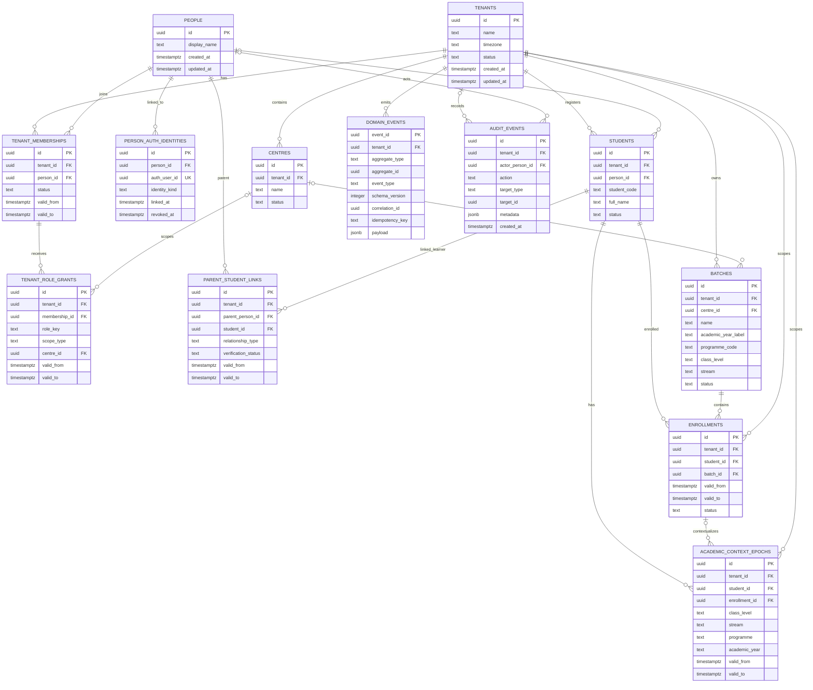
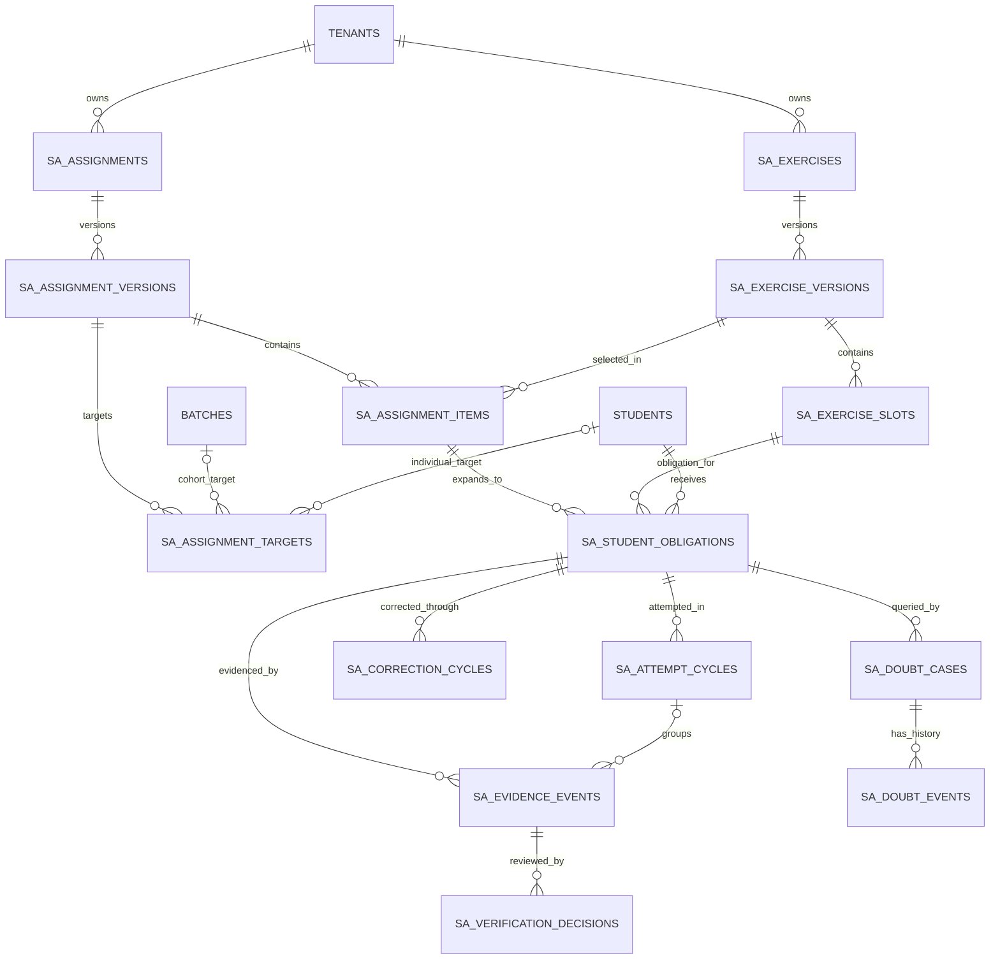

# PULSE — Canonical Core ERD, Data Dictionary and Authorization Matrix

- Document ID: PULSE-DATA-CORE-002
- Version: 0.1.0
- Status: Draft — derived from proposed logical model; pending owner approval
- Date: 2026-11-06
- Parent: `PULSE-DATA-CORE-001`
- Implementation authorization: Not granted
- Migration authorization: Not granted

## 1. Purpose and source boundary

This document translates the proposed logical model in `PULSE-DATA-CORE-001` into a reviewable entity relationship model, core data dictionary and authorization matrix.

It is a design artifact, not executable SQL, not an approved database schema and not a statement that these tables exist in the live Supabase project. Field types below are proposed PostgreSQL types and must be validated against approved product decisions and the full source migrations before implementation.

## 2. Canonical core ERD

The following diagram shows the proposed shared platform and academic-core relationships. It intentionally excludes System A operational tables from the shared core; those are shown in Section 3.



### 2.1 Cardinality and relationship rules

- A tenant has many memberships, centres, students, batches and tenant-scoped events.
- A person may have memberships in multiple tenants.
- A membership may have multiple role grants over time and at different permitted scopes.
- A student belongs to exactly one tenant; a person link may be absent until identity resolution.
- A parent person may have multiple verified or pending student links; each link is tenant-scoped and time-bounded.
- A batch belongs to one tenant and optionally one centre.
- A student may have multiple historical enrollments. Concurrent active enrollment policy is a pending academic decision.
- Academic context epochs belong to a student and may be associated with a specific enrollment.
- Domain events and audit events are not substitutes for System A evidence events or verification decisions.

## 3. System A relationship extension

The following is the module-owned extension to the shared core. It is intentionally a separate diagram so shared identity and academic organization do not absorb Student Tracking behavior.



Every tenant-owned System A table must carry the tenant key and use tenant-qualified foreign keys to shared and module-owned parents. The exact field dictionary for all System A operational entities remains subject to a separate module data dictionary; this document does not replace its functional specification.

## 4. Shared core data dictionary

Types are proposals. `NOT NULL`, uniqueness and default rules are subject to the decisions in Section 8.

### 4.1 tenants

| Column | Proposed type | Null? | Key / rule | Description |
|---|---|---|---|---|
| id | uuid | No | PK, default gen_random_uuid() | Stable tenant identity |
| name | text | No | Trimmed non-empty | Institute display/legal name |
| timezone | text | No | IANA timezone validation | Tenant-local time interpretation |
| status | text | No | ACTIVE/SUSPENDED/ARCHIVED | Tenant lifecycle |
| created_at | timestamptz | No | Server default | Creation timestamp |
| updated_at | timestamptz | No | Server maintained | Last update timestamp |

### 4.2 people

| Column | Proposed type | Null? | Key / rule | Description |
|---|---|---|---|---|
| id | uuid | No | PK | Global person identity |
| display_name | text | Yes | Trim if present | Preferred display name |
| created_at | timestamptz | No | Server default | Creation timestamp |
| updated_at | timestamptz | No | Server maintained | Last update timestamp |

Contact data is excluded from this baseline until privacy, verification, uniqueness and retention requirements are approved.

### 4.3 person_auth_identities

| Column | Proposed type | Null? | Key / rule | Description |
|---|---|---|---|---|
| id | uuid | No | PK | Identity-link record |
| person_id | uuid | No | FK people; index | Linked person |
| auth_user_id | uuid | No | FK auth.users; UNIQUE | Auth account |
| identity_kind | text | No | Controlled vocabulary | Provider/account kind |
| linked_at | timestamptz | No | Server default | Link timestamp |
| revoked_at | timestamptz | Yes | Must be >= linked_at | Revocation timestamp |
| linked_by | uuid | Yes | Trusted actor reference | Link provenance |

### 4.4 tenant_memberships

| Column | Proposed type | Null? | Key / rule | Description |
|---|---|---|---|---|
| id | uuid | No | PK | Membership identity |
| tenant_id | uuid | No | FK tenants; composite key | Institute |
| person_id | uuid | No | FK people | Person |
| status | text | No | INVITED/ACTIVE/SUSPENDED/LEFT/REVOKED | Membership state |
| valid_from | timestamptz | No | Effective start | Membership start |
| valid_to | timestamptz | Yes | Greater than valid_from | Membership end |
| created_at | timestamptz | No | Server default | Creation |
| created_by | uuid | Yes | Trusted actor reference | Provenance |

### 4.5 tenant_role_grants

| Column | Proposed type | Null? | Key / rule | Description |
|---|---|---|---|---|
| id | uuid | No | PK | Role grant identity |
| tenant_id | uuid | No | Tenant-qualified FK | Institute |
| membership_id | uuid | No | Tenant-qualified FK | Membership receiving grant |
| role_key | text | No | Approved role catalogue | Granted role |
| scope_type | text | No | TENANT/CENTRE | Authorization scope |
| centre_id | uuid | Conditional | Required for CENTRE; tenant-qualified FK | Centre scope |
| valid_from | timestamptz | No | Effective start | Grant start |
| valid_to | timestamptz | Yes | Greater than valid_from | Grant end |
| granted_by | uuid | No | Trusted actor | Grantor |
| revoked_by | uuid | Yes | Trusted actor | Revoker |
| reason | text | Yes | Audit requirement by action | Grant/revocation rationale |

### 4.6 centres

| Column | Proposed type | Null? | Key / rule | Description |
|---|---|---|---|---|
| id | uuid | No | PK | Centre identity |
| tenant_id | uuid | No | FK tenants; UNIQUE (tenant_id,id) | Owning tenant |
| name | text | No | Tenant-local uniqueness | Centre name |
| status | text | No | ACTIVE/INACTIVE | Lifecycle |
| created_at | timestamptz | No | Server default | Creation |
| created_by | uuid | Yes | Trusted actor | Provenance |

### 4.7 students

| Column | Proposed type | Null? | Key / rule | Description |
|---|---|---|---|---|
| id | uuid | No | PK | Institute learner identity |
| tenant_id | uuid | No | FK tenants; UNIQUE (tenant_id,id) | Owning tenant |
| person_id | uuid | Yes | FK people | Resolved human identity |
| student_code | text | No | UNIQUE (tenant_id,student_code) | Institute-local identifier |
| full_name | text | No | Trimmed non-empty | Operational display name |
| status | text | No | ACTIVE/INACTIVE/TRANSFERRED/ARCHIVED | Learner record lifecycle |
| created_at | timestamptz | No | Server default | Creation |
| updated_at | timestamptz | No | Server maintained | Last update |

### 4.8 parent_student_links

| Column | Proposed type | Null? | Key / rule | Description |
|---|---|---|---|---|
| id | uuid | No | PK | Relationship identity |
| tenant_id | uuid | No | Tenant-qualified FK | Institute |
| parent_person_id | uuid | No | FK people | Parent/guardian person |
| student_id | uuid | No | Tenant-qualified FK students | Linked learner |
| relationship_type | text | Yes | Configurable controlled value | Relationship label |
| verification_status | text | No | PENDING/VERIFIED/REVOKED | Authorization state |
| valid_from | timestamptz | No | Effective start | Relationship start |
| valid_to | timestamptz | Yes | Greater than valid_from | Relationship end |
| verified_by | uuid | Yes | Trusted actor | Verifier |
| verified_at | timestamptz | Yes | Timestamp | Verification time |

### 4.9 batches

| Column | Proposed type | Null? | Key / rule | Description |
|---|---|---|---|---|
| id | uuid | No | PK | Batch identity |
| tenant_id | uuid | No | FK tenants; UNIQUE (tenant_id,id) | Owning tenant |
| centre_id | uuid | Yes | Tenant-qualified FK centres | Centre |
| name | text | No | Tenant-local uniqueness policy | Batch label |
| academic_year_label | text | Yes | Display only | Academic year label |
| programme_code | text | Yes | Tenant-configured | Programme |
| class_level | text | Yes | Tenant-configured | Class |
| stream | text | Yes | Tenant-configured | Stream |
| status | text | No | ACTIVE/INACTIVE/ARCHIVED | Lifecycle |
| starts_on | date | Yes | ends_on >= starts_on | Start date |
| ends_on | date | Yes | | End date |

### 4.10 enrollments

| Column | Proposed type | Null? | Key / rule | Description |
|---|---|---|---|---|
| id | uuid | No | PK | Enrollment identity |
| tenant_id | uuid | No | FK tenants; UNIQUE (tenant_id,id) | Institute |
| student_id | uuid | No | Tenant-qualified FK students | Learner |
| batch_id | uuid | No | Tenant-qualified FK batches | Batch |
| valid_from | timestamptz | No | Effective start | Enrollment start |
| valid_to | timestamptz | Yes | Greater than valid_from | Enrollment end |
| status | text | No | ACTIVE/TRANSFERRED/WITHDRAWN/COMPLETED | Enrollment state |
| created_at | timestamptz | No | Server default | Creation |
| created_by | uuid | Yes | Trusted actor | Provenance |
| ended_reason | text | Yes | Controlled reason recommended | Closure reason |

### 4.11 academic_context_epochs

| Column | Proposed type | Null? | Key / rule | Description |
|---|---|---|---|---|
| id | uuid | No | PK | Context epoch identity |
| tenant_id | uuid | No | Tenant-qualified FK | Institute |
| student_id | uuid | No | Tenant-qualified FK students | Learner |
| enrollment_id | uuid | Yes | Tenant-qualified FK enrollments | Related enrollment |
| class_level | text | Yes | Tenant-configured | Class level |
| stream | text | Yes | Tenant-configured | Stream |
| programme | text | Yes | Tenant-configured | Programme |
| academic_year | text | Yes | Tenant-configured | Academic year |
| valid_from | timestamptz | No | Effective start | Context start |
| valid_to | timestamptz | Yes | Greater than valid_from | Context end |
| reason | text | Yes | | Change reason |
| created_at | timestamptz | No | Server default | Creation |
| created_by | uuid | Yes | Trusted actor | Provenance |

### 4.12 domain_events and audit_events

| Table | Key columns | Purpose and constraints |
|---|---|---|
| domain_events | event_id, tenant_id, aggregate_type, aggregate_id, event_type, event_version, schema_version, occurred_at, recorded_at, actor_id, correlation_id, causation_id, idempotency_key, payload | Generic integration/event envelope; unique tenant + idempotency key; payload schema/version governed |
| audit_events | id, tenant_id, actor_person_id, action, target_type, target_id, reason, metadata, created_at | Security and administrative activity; ordinary mutation/deletion prohibited |

These are separate from System A's evidence events. Do not put the entire student reporting and verification lifecycle into a generic `domain_events` JSON payload.

## 5. Key constraints and indexes

### 5.1 Required composite keys

Every parent referenced by a tenant-scoped child must expose `UNIQUE (tenant_id, id)`. Child references should use composite foreign keys, for example:

```sql
FOREIGN KEY (tenant_id, student_id)
  REFERENCES public.students (tenant_id, id)
```

Use this pattern for centre, membership, student, batch, enrollment and System A parent references. Independent foreign keys to tenant and parent IDs do not prove that both belong to the same tenant.

### 5.2 Candidate indexes

- `tenant_memberships(tenant_id, person_id, status)`
- `tenant_role_grants(tenant_id, membership_id, role_key, valid_from)`
- `students(tenant_id, student_code)`
- `students(tenant_id, person_id)`
- `enrollments(tenant_id, student_id, valid_from DESC)`
- `enrollments(tenant_id, batch_id, valid_from)`
- `academic_context_epochs(tenant_id, student_id, valid_from DESC)`
- System A obligations `(tenant_id, student_id, eligibility_status)`
- System A evidence `(tenant_id, obligation_id, server_sequence)`
- System A verification `(tenant_id, evidence_event_id, decided_at DESC)`

Indexes are candidates; validate with workload and query plans before adding them.

## 6. Authorization matrix

Legend:
- **Own**: actor's own record only.
- **Linked**: verified and currently valid parent-student link.
- **Assigned**: explicit centre, batch, learner or queue assignment.
- **Tenant**: authorized tenant scope.
- **Policy**: requires a separately approved grant or workflow.
- **No**: denied.

| Resource/action | Student | Parent | Teacher | Mentor | Academic reviewer | Institute admin | Platform admin |
|---|---|---|---|---|---|---|---|
| Read own profile | Own | Linked | Assigned | Assigned | Assigned | Tenant | Policy |
| Read student profile | Own | Linked | Assigned | Assigned | Assigned | Tenant | Policy |
| Read batch roster | No | No | Assigned | Assigned | Assigned | Tenant | Policy |
| Read own enrollment/context | Own | Linked | Assigned | Assigned | Assigned | Tenant | Policy |
| Manage batch/enrollment | No | No | No by default | No | No | Tenant | Policy |
| Read own obligations | Own | Linked | Assigned | Assigned | Assigned | Tenant | Policy |
| Create exercise/assignment | No | No | Assigned | No by default | Policy | Policy | Policy |
| Approve/publish assignment | No | No | Policy; separation-of-duties | No by default | Assigned | Policy | Policy |
| Append student self-report | Own | No | No | No | No | No | No |
| Append teacher observation | No | No | Assigned | Policy | Policy | Policy | Policy |
| Verify evidence | No | No | Policy; separate actor preferred | Policy | Assigned | Policy | Policy |
| Open doubt case | Own | Policy | Assigned | Assigned | Assigned | Policy | Policy |
| Resolve doubt case | No | No | Assigned | Assigned | Assigned | Policy | Policy |
| Open correction cycle | Own request | No | Assigned | Policy | Assigned | Policy | Policy |
| Accept correction | No | No | Policy | Policy | Assigned | Policy | Policy |
| Manage memberships | No | No | No | No | No | Tenant | Policy |
| Grant/revoke tenant roles | No | No | No | No | No | Tenant with audit | Policy |
| Read tenant audit log | No | No | No | No | Policy | Tenant | Policy |
| Read cross-tenant data | No | No | No | No | No | No | Exceptional, audited |

This matrix is a proposed baseline, not final permissions. Platform administrator access must be a separate privileged support mechanism with explicit justification, time-bounded elevation and immutable audit evidence. It must not become an ordinary cross-tenant read policy.

### 6.1 Authorization predicate

A successful authorization decision should require all applicable conditions:
1. Auth user resolves to an active person identity.
2. Person has an active tenant membership.
3. Required role grant is active at the relevant effective time.
4. Grant scope contains the target resource's tenant/centre/batch/learner scope.
5. Resource-specific relationship applies (for example, parent-student link or own student profile).
6. Action-specific workflow and separation-of-duties constraints pass.

The tenant ID supplied by the client is a selector, not proof of authorization.

## 7. RLS policy design checklist

For each exposed table, document:
- SELECT actors and row predicate;
- INSERT actors and trusted actor derivation;
- UPDATE actors, `USING` and `WITH CHECK`;
- DELETE policy (normally denied for academic evidence and audit records);
- grants to `anon`, `authenticated` and trusted server roles;
- RPC execute permissions and internal authorization;
- view security behavior;
- Storage access, if any;
- cross-tenant negative tests.

No policy should rely only on `auth.uid() IS NOT NULL` or a client-supplied role. Do not use user-editable Auth metadata as authorization evidence. Review SECURITY DEFINER functions and ensure least privilege, fixed search path, safe ownership and restricted execute grants.

## 8. Decisions still open

| Decision ID | Question | Owner |
|---|---|---|
| CORE-DEC-001 | Is one Auth user restricted to one person identity? | Product + security |
| CORE-DEC-002 | Can one person have multiple student profiles in one tenant? | Academic owner |
| CORE-DEC-003 | Are concurrent active batch enrollments allowed? | Academic owner |
| CORE-DEC-004 | Which roles can be centre-scoped? | Product + operations |
| CORE-DEC-005 | What verifies a parent-student relationship? | Product + privacy/security |
| CORE-DEC-006 | What academic context dimensions are mandatory/configurable? | Academic owner |
| CORE-DEC-007 | Are subjects global, tenant-owned or both? | Product + academic owner |
| CORE-DEC-008 | Which actions require independent approval? | Product + security |
| CORE-DEC-009 | What is the platform support elevation process? | Security + operations |
| CORE-DEC-010 | Which domain events are persisted versus emitted through an async mechanism? | Technical owner |

No default in this document should be interpreted as an approved decision.

## 9. Validation test matrix

| Test ID | Scenario | Expected result |
|---|---|---|
| AUTH-001 | Auth user has no active person identity | Tenant data denied |
| AUTH-002 | Person has no active tenant membership | Tenant data denied |
| AUTH-003 | Membership exists but role grant is absent/expired | Privileged action denied |
| AUTH-004 | Teacher scoped to Centre A requests Centre B roster | Denied |
| AUTH-005 | Parent requests an unlinked student | Denied |
| AUTH-006 | Parent link is revoked/expired | Subsequent access denied |
| AUTH-007 | Student submits report for another student's obligation | Denied |
| AUTH-008 | Client changes actor ID or role in payload | Trusted actor remains Auth-derived; impersonation denied |
| TEN-001 | Child row combines tenant A with tenant B student ID | Composite FK rejects write |
| TEN-002 | Batch belongs to another tenant | Enrollment write rejected |
| TEN-003 | Centre belongs to another tenant | Scoped grant/batch write rejected |
| LIFE-001 | Batch transfer occurs | Historical enrollment and evidence retained |
| LIFE-002 | Role grant expires | New protected operations denied |
| EVD-001 | Ordinary user updates/deletes evidence | Denied |
| EVD-002 | Duplicate idempotency key is retried | One logical effect; deterministic response |
| INT-001 | QBMS question ID is absent | System A assignment remains valid |
| INT-002 | DTE mapping is absent | System A tracking remains valid |
| INT-003 | Later classification is added | Source evidence unchanged; derived enrichment traceable |

## 10. Review and approval gates

- [ ] Product owner approves tenant, person and membership semantics.
- [ ] Academic owner approves student, batch, enrollment and academic context semantics.
- [ ] Security reviewer approves role scopes, parent access and privileged support model.
- [ ] Technical owner approves table names, field types, keys and migration lineage.
- [ ] Full System A migration has been checked against this dictionary, including all omitted module-owned tables.
- [ ] Live Supabase state has been re-audited.
- [ ] RLS/grant matrix and negative integration tests are implemented in an isolated environment.
- [ ] ERD is regenerated from the approved schema after migration implementation.

**Current disposition:** Draft only. No SQL was applied. No migration file, production database, deployment setting, pull request state or branch history was changed by this document.
