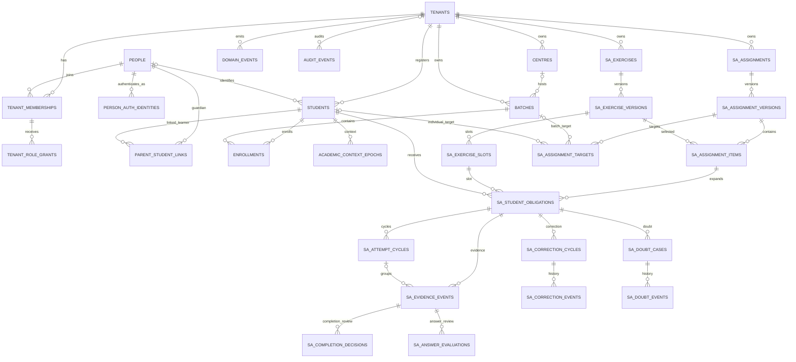

# PULSE — Canonical Physical ERD and Data Dictionary

- Document ID: PULSE-DATA-CORE-009
- Version: 0.1.0
- Status: Draft — consolidated physical proposal; product, academic, technical and security approval pending
- Date: 2026-11-06
- Parents: PULSE-DATA-CORE-001 through PULSE-DATA-CORE-008
- Target: Supabase PostgreSQL
- SQL / migration / live database authorization: NOT GRANTED

## 1. Purpose and authority

This document consolidates the shared platform identity/academic core and System A operational schema into one proposed physical model. It resolves ownership duplication identified in the V10 and System A migration audits and provides a table/column-level starting point for implementation planning.

This is a design proposal, not executable SQL, not an approved schema and not evidence that any listed object exists. Proposed types and constraints require product decisions, isolated migration replay and security review. No existing migration is approved for application unchanged.

## 2. Consolidated architecture and ownership

| Owner | Entities |
|---|---|
| Platform identity | tenants, people, person_auth_identities, tenant_memberships, tenant_role_grants |
| Shared academic core | centres, students, parent_student_links, batches, enrollments, academic_context_epochs |
| Platform governance | domain_events, audit_events, private command_idempotency, private outbox_events |
| System A content | sa_exercises, sa_exercise_versions, sa_exercise_slots |
| System A assignment | sa_assignments, sa_assignment_versions, sa_assignment_items, sa_assignment_targets, sa_assignment_lifecycle_events |
| System A learner work | sa_student_obligations, sa_attempt_cycles, sa_evidence_events |
| System A decisions | sa_completion_decisions, sa_answer_evaluations |
| System A workflows | sa_correction_cycles, sa_correction_events, sa_doubt_cases, sa_doubt_events |
| System A scope/metrics | sa_resource_assignments, sa_metric_policy_versions |

### 2.1 Replacement and exclusion decisions

1. Replace `sa_institutes` with canonical `tenants`.
2. Replace `sa_institute_memberships` with `tenant_memberships` plus `tenant_role_grants`; membership is not a permission.
3. Replace `sa_students` with canonical `students`; Auth identity is linked through `person_auth_identities` and optional `students.person_id`.
4. Replace `sa_parent_student_links` with canonical verified, revocable `parent_student_links`.
5. Replace `sa_centres`, `sa_batches` and `sa_batch_memberships` with canonical `centres`, `batches` and time-bounded `enrollments`.
6. Replace `sa_audit_events` with shared `audit_events`.
7. Do not retain `sa_subjects` or `sa_chapters` as System A master tables. DTE is configurable classification-management software, not a hard-coded chapter/curriculum authoring hierarchy. Optional external classification references may be stored, but Student Tracking must work without them.
8. Split source `sa_verification_decisions` into `sa_completion_decisions` and `sa_answer_evaluations` so completion and correctness remain separate facts and permissions.
9. Add append-only `sa_correction_events` and `sa_assignment_lifecycle_events`; mutable status fields are projections, not the full history.
10. Add explicit teacher/reviewer resource scope through `sa_resource_assignments` or an approved shared equivalent.

## 3. Consolidated ERD

Every tenant-owned parent exposes `UNIQUE (tenant_id,id)`. Tenant-owned children reference it through composite `(tenant_id,parent_id)` foreign keys. A standalone FK to a UUID does not prove same-tenant ownership.

## 4. Shared core data dictionary

Types are proposed. UUID PKs default to `gen_random_uuid()`. All timestamps are `timestamptz` in UTC. Human actor fields reference `people.id`, never a browser-supplied Auth UID.

### 4.1 `tenants`

| Column | Type | Required | Rule |
|---|---|---:|---|
| id | uuid | Yes | PK |
| name | text | Yes | Trimmed, 1–200 chars |
| timezone | text | Yes | Valid IANA zone |
| status | text | Yes | ACTIVE / SUSPENDED / ARCHIVED |
| created_at, updated_at | timestamptz | Yes | Server maintained |

### 4.2 `people` and `person_auth_identities`

| Table | Columns | Rules |
|---|---|---|
| people | id, display_name, status, created_at, updated_at | Global minimal identity; avoid unnecessary PII |
| person_auth_identities | id, person_id, auth_user_id, identity_provider, linked_at, linked_by_person_id, revoked_at, revoked_by_person_id | Auth UID unique; exactly one active mapping; trusted link/revoke workflow |

### 4.3 `tenant_memberships` and `tenant_role_grants`

| Table | Columns | Rules |
|---|---|---|
| tenant_memberships | id, tenant_id, person_id, status, valid_from, valid_to, created_at, created_by_person_id | UNIQUE (tenant_id,id); effective-dated; membership is not permission |
| tenant_role_grants | id, tenant_id, membership_id, role_key, scope_type, centre_id, valid_from, valid_to, granted_by_person_id, revoked_by_person_id, reason | Membership FK tenant-qualified; scope TENANT/CENTRE; CENTRE requires same-tenant centre; role-to-action mapping is versioned |

### 4.4 `centres`, `students`, `parent_student_links`

| Table | Columns | Rules |
|---|---|---|
| centres | id, tenant_id, name, status, created_at, updated_at, created_by_person_id | UNIQUE (tenant_id,id); tenant-local name |
| students | id, tenant_id, person_id nullable, student_code, full_name, status, created_at, updated_at | UNIQUE (tenant_id,id), UNIQUE (tenant_id,student_code); learner can exist before login/person link |
| parent_student_links | id, tenant_id, parent_person_id, student_id, relationship_type, verification_status, valid_from, valid_to, verified_by_person_id, verified_at, revoked_by_person_id, revoked_at | Student FK tenant-qualified; only verified/effective links permit parent projections |

### 4.5 `batches`, `enrollments`, `academic_context_epochs`

| Table | Columns | Rules |
|---|---|---|
| batches | id, tenant_id, centre_id nullable, name, academic_year_label, programme_code, class_level, stream, status, starts_on, ends_on, created_at, updated_at | UNIQUE (tenant_id,id); centre same tenant; descriptors are tenant-configurable, not a universal taxonomy |
| enrollments | id, tenant_id, student_id, batch_id, valid_from, valid_to, status, created_at, created_by_person_id, ended_reason | Student and batch FKs tenant-qualified; preserve history; concurrent active enrollment policy pending |
| academic_context_epochs | id, tenant_id, student_id, enrollment_id nullable, class_level, stream, programme, academic_year, valid_from, valid_to, reason, created_at, created_by_person_id | Student/enrollment tenant-qualified; historical context snapshot |

### 4.6 `domain_events` and `audit_events`

| Table | Columns | Rules |
|---|---|---|
| domain_events | event_id, tenant_id, aggregate_type, aggregate_id, event_type, event_version, schema_version, actor_person_id, occurred_at, recorded_at, correlation_id, causation_id, idempotency_key, payload | Versioned integration envelope; not a substitute for academic evidence |
| audit_events | id, tenant_id nullable only for platform events, actor_person_id, action, target_type, target_id, reason, metadata, correlation_id, created_at | Append-only; restricted readers; no secrets or unnecessary PII |

## 5. System A data dictionary

All rows are tenant-owned and use composite tenant-qualified FKs. `created_by_person_id` and actor fields are trusted canonical person references. Published versions and evidence/decision history are immutable.

| Table | Core columns | Key constraints / rules |
|---|---|---|
| sa_exercises | id, tenant_id, created_by_person_id, status, current_version_id, created_at, updated_at | UNIQUE (tenant_id,id); draft aggregate; version pointer same tenant |
| sa_exercise_versions | id, tenant_id, exercise_id, version_no, title, instructions, question_count, created_by_person_id, created_at, published_at | Unique tenant/exercise/version; published version immutable |
| sa_exercise_slots | id, tenant_id, exercise_version_id, slot_no, display_label, question_type, max_marks, positive_marks, negative_marks, external_question_ref, external_question_version_ref, classification_ref, created_at | Unique version/slot; external QBMS/DTE refs optional and version-aware; no duplicated question content |
| sa_assignments | id, tenant_id, created_by_person_id, current_version_id, status, created_at, updated_at | UNIQUE (tenant_id,id); status is projection |
| sa_assignment_versions | id, tenant_id, assignment_id, version_no, title, instructions, release_at, due_at, timezone, created_by_person_id, created_at | Unique tenant/assignment/version; immutable after approval |
| sa_assignment_items | id, tenant_id, assignment_version_id, exercise_version_id, item_order, created_at | Both parents tenant-qualified; unique assignment version/order |
| sa_assignment_targets | id, tenant_id, assignment_version_id, target_kind, batch_id nullable, student_id nullable, created_at | Exactly one target; same-tenant target; publication snapshot |
| sa_assignment_lifecycle_events | id, tenant_id, assignment_id, assignment_version_id, event_type, actor_person_id, reason, occurred_at, idempotency_key, payload | Append-only; approval/publication/return/cancel/amend history |
| sa_student_obligations | id, tenant_id, assignment_version_id, assignment_item_id, exercise_slot_id, student_id, source_batch_id nullable, publication_id, eligibility_status, created_at | Must prove item/version/slot chain and same student/tenant; source single-column assignment_item FK is insufficient |
| sa_attempt_cycles | id, tenant_id, obligation_id, cycle_no, cycle_kind, started_at, created_by_person_id | Unique obligation/cycle; actor and obligation scope validated |
| sa_evidence_events | id, tenant_id, obligation_id, attempt_cycle_id nullable, event_type, work_status, source_actor_person_id, source_channel, occurred_at_client, recorded_at_server, server_sequence, idempotency_key, payload, causation_event_id | Append-only; event type STUDENT_REPORT / TEACHER_OBSERVATION / SYSTEM_IMPORT; client actor role never trusted |
| sa_completion_decisions | id, tenant_id, evidence_event_id, obligation_id, outcome, reason, decided_by_person_id, decided_at, supersedes_decision_id, idempotency_key | Append-only; CONFIRMED / RETURNED / REJECTED; exact evidence and obligation must match |
| sa_answer_evaluations | id, tenant_id, evidence_event_id, obligation_id, outcome, marks_awarded, evaluation_method, evaluated_by_person_id, evaluated_at, supersedes_evaluation_id, reason_or_feedback, idempotency_key | Append-only; CORRECT / INCORRECT / PARTIALLY_CORRECT / NOT_EVALUATED / NOT_APPLICABLE; separate from completion |
| sa_correction_cycles | id, tenant_id, obligation_id, source_completion_decision_id, opened_by_person_id, opened_at, closed_at, current_status | Source must be RETURNED decision for same obligation; status projection |
| sa_correction_events | id, tenant_id, correction_cycle_id, event_type, actor_person_id, evidence_event_id nullable, decision_id nullable, reason, occurred_at, idempotency_key | Append-only transition history |
| sa_doubt_cases | id, tenant_id, obligation_id, opened_by_person_id, assigned_to_person_id nullable, current_status, priority, created_at, resolved_at | Same-tenant obligation; assigned actor scope validated; status projection |
| sa_doubt_events | id, tenant_id, doubt_case_id, event_type, actor_person_id, body, occurred_at, idempotency_key | Append-only; add source-missing immutable protection |
| sa_resource_assignments | id, tenant_id, person_id, resource_type, resource_id, permission_key, valid_from, valid_to, assigned_by_person_id, revoked_at | Resource must be validated against typed FK or normalized resource registry; polymorphic UUID alone is insufficient |
| sa_metric_policy_versions | id, tenant_id, version_no, policy, effective_from, effective_to, created_by_person_id, approved_by_person_id, created_at | Unique tenant/version; immutable after approval; non-overlapping effective periods |

### 5.1 External classification and question references

System A does not own question identity or a fixed subject/chapter tree. A slot may carry optional source references to QBMS question identity/version or an opaque DTE classification mapping. These references must not be required for assignment, obligation, evidence, verification or reporting. If an external provider identifier is not yet stable, store a namespaced opaque reference and resolve it through a reviewed integration contract.

## 6. Internal command infrastructure

| Object | Proposed columns | Access / behavior |
|---|---|---|
| app_private.command_idempotency | id, tenant_id, actor_person_id, command_name, idempotency_key, request_fingerprint, result_reference, created_at, expires_at | Internal only; same key/same fingerprint replays; same key/different fingerprint rejects |
| app_private.outbox_events | id, tenant_id, event_type, aggregate_type, aggregate_id, payload, created_at, available_at, attempt_count, processed_at, last_error_code, correlation_id | Internal worker only; inserted in originating transaction; bounded retries |

## 7. Mandatory relationship invariants

1. Every tenant-owned parent exposes UNIQUE (tenant_id,id); child FKs include tenant_id.
2. Assignment item belongs to exact assignment version and selected exercise version.
3. Obligation assignment version is the parent of its assignment item.
4. Obligation slot belongs to the exercise version selected by that item.
5. Publication target, roster snapshot, batch/student and obligation belong to the same tenant.
6. Attempt cycle belongs to the same obligation; evidence attempt cycle, if present, belongs to that obligation.
7. Completion decision and answer evaluation reference evidence and the same obligation.
8. Correction cycle references an eligible RETURNED completion decision for the same obligation.
9. Parent access requires currently verified, effective guardian link and field/purpose-specific permission.
10. Resource assignments reference valid tenant-owned resources and effective permission scope.
11. Membership and role grant are separate; role grant must belong to the same tenant membership.
12. Revoked/expired identity, membership or grant denies the next authorization check.

## 8. Candidate indexes

- tenant_memberships(tenant_id, person_id, status, valid_from)
- tenant_role_grants(tenant_id, membership_id, role_key, valid_from, valid_to)
- students(tenant_id, student_code) and (tenant_id, person_id)
- parent_student_links(tenant_id, parent_person_id, verification_status, valid_to)
- enrollments(tenant_id, student_id, valid_from) and (tenant_id, batch_id, valid_from)
- academic_context_epochs(tenant_id, student_id, valid_from DESC)
- sa_student_obligations(tenant_id, student_id, eligibility_status)
- sa_evidence_events(tenant_id, obligation_id, server_sequence)
- sa_completion_decisions(tenant_id, evidence_event_id, decided_at DESC)
- sa_answer_evaluations(tenant_id, evidence_event_id, evaluated_at DESC)
- sa_doubt_cases(tenant_id, current_status, priority, created_at)
- sa_resource_assignments(tenant_id, person_id, resource_type, resource_id, valid_from)

Validate index candidates with actual workload and query plans; do not create all indexes blindly.

## 9. Authorization and mutation baseline

| Resource | SELECT | INSERT | UPDATE | DELETE |
|---|---|---|---|---|
| Tenant, people, Auth links | Self and explicitly authorized tenant/platform administration | Trusted onboarding | Narrow identity/admin workflow | No app-role delete |
| Memberships and grants | Self and authorized grant admins | Trusted membership/grant commands | Effective-date/revoke only | No app-role delete |
| Students and guardian links | Student own, verified parent projection, assigned staff | Roster/verification commands | Narrow profile/lifecycle command | Archive/revoke; no physical delete |
| Batches/enrollments | Assigned staff and permitted own learner/parent projection | Roster command | Scoped lifecycle command | No app-role delete |
| Exercise/assignment drafts | Authorized author/reviewer | Draft/version command | Draft only before approval | Archive; no physical delete |
| Published versions/targets | Authorized staff and target learners by lifecycle | Publication transaction only | No mutation; amendment creates new version/event | No |
| Obligations/attempts | Own learner, verified guardian projection, assigned staff | Publication or trusted learner command | Narrow projection/eligibility command | No |
| Evidence/decisions/workflow events | Own and authorized review projection | Purpose-specific trusted command | No | No |
| Audit/domain/idempotency/outbox | Restricted audit/internal readers | Trusted transaction/worker | Worker-owned delivery state only | Retention-controlled internal process |

RLS and grants must be designed together. No generic tenant-member policy. Sensitive writes use narrow trusted commands deriving actor from `auth.uid()` and resolving person, membership, action grant and resource scope inside the database. Views, functions, triggers and storage are separate authorization surfaces.

## 10. Open blocking decisions

| ID | Decision | Owner(s) | Recommended default |
|---|---|---|---|
| CORE-009-01 | Concurrent active enrollments | Academic/product | Permit multiple only when programme/batch semantics require; no global one-batch rule by default |
| CORE-009-02 | Guardian verification evidence and process | Product/privacy/operations | PENDING by default; verified workflow and revocation history |
| CORE-009-03 | Role catalogue and role-to-action mapping | Product/security | Explicit versioned mapping and scoped grants |
| CORE-009-04 | Teacher/reviewer resource scope | Product/technical/security | Typed FKs or normalized resource registry |
| CORE-009-05 | Assignment publication roster snapshot | Academic/product | Immutable publication-time snapshot; amendments explicit |
| CORE-009-06 | Author/approver/publisher separation | Academic/security | No self-approval for privileged publication |
| CORE-009-07 | Evidence vocabulary and repeated reports | Academic | Append-only reports; state is a versioned projection |
| CORE-009-08 | Completion versus correctness | Academic | Separate records, permissions and timelines |
| CORE-009-09 | Correction and doubt closure/reopening | Academic | Append-only event history |
| CORE-009-10 | Metric policy intervals | Academic/data | Immutable versions, non-overlapping intervals |
| CORE-009-11 | QBMS/DTE reference contracts | QBMS/DTE/product | Optional, namespaced and version-aware |
| CORE-009-12 | PII placement, retention and export | Privacy/security | Minimal global person record; purpose-limited tenant data |
| CORE-009-13 | Idempotency and outbox retention | Technical/operations | Documented TTL, bounded retry and auditable failure handling |

## 11. Migration sequence and validation gates

Proposed dependency order: (1) private schemas/extensions/ledger; (2) tenants/people/Auth identity; (3) memberships/role grants/centres; (4) students/guardian links/batches/enrollments/context; (5) platform audit/domain events; (6) exercises/versions/slots; (7) assignments/versions/items/targets/lifecycle events; (8) publication snapshots/obligations; (9) attempts/evidence; (10) separate completion decisions and answer evaluations; (11) correction/doubt history; (12) resource assignments/metric policies/idempotency/outbox; (13) RLS, grants, functions, triggers and views; (14) workload indexes and operational jobs.

Required tests: empty-database migration replay; composite-FK coverage; cross-tenant reference denial; missing/revoked identity denial; membership-without-grant denial; expired grant denial; verified-parent-only access; teacher/reviewer scope denial; client actor/role spoofing denial; append-only enforcement; separate completion/correctness behavior; atomic publication under injected failure and concurrent retry; idempotency replay/conflict; complete obligation chain validation; audited and field-minimized export; query-plan review.

## 12. Required approvals

- [ ] Product owner approves canonical tenant/person/membership semantics.
- [ ] Academic owner approves enrollment, guardian, assignment publication and evidence lifecycle.
- [ ] Security owner approves action grants, resource scope, RLS, grants and privileged functions.
- [ ] Technical owner approves physical entities, keys, constraints and migration lineage.
- [ ] QBMS/DTE owners approve optional external-reference semantics.
- [ ] Privacy owner approves PII, retention and export policy.
- [ ] Unified migration replay and RLS/RPC/cross-tenant/concurrency tests pass in an isolated environment.
- [ ] Explicit authorization is recorded before any live Supabase migration.

## 13. Final disposition

PULSE-DATA-CORE-009 consolidates the target physical model and identifies the remaining blocking decisions. It does not authorize SQL generation, migration application, production access, deployment promotion or PR merge. Live Supabase remains unchanged. System A remains independent of QBMS question content and DTE taxonomy configuration.
