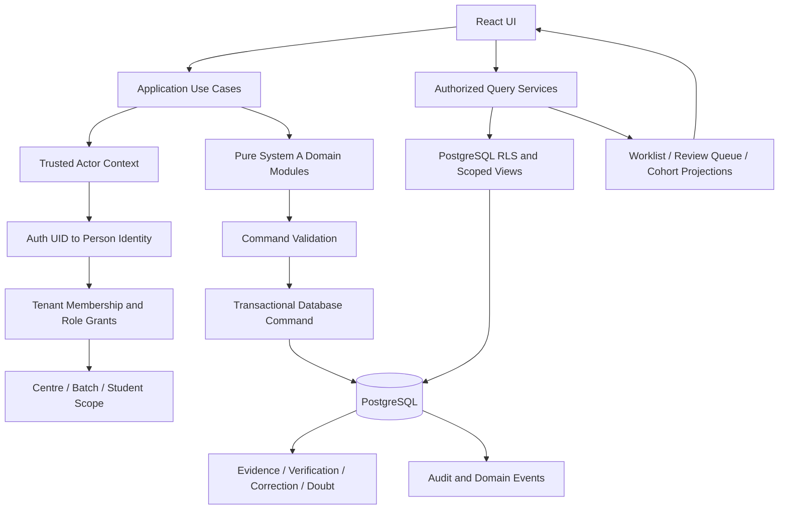

# PULSE — System A Application Service and API Contract

- Document ID: PULSE-DATA-CORE-006
- Version: 0.1.0
- Status: Draft — proposed service boundary; product, technical and security approval pending
- Date: 2026-11-06
- Parent: `PULSE-DATA-CORE-001` through `PULSE-DATA-CORE-005`
- Implementation authorization: Not granted
- Database/API deployment authorization: Not granted

## 1. Purpose

Define the trusted application boundary that connects the System A UI and pure domain modules to canonical identity, tenant authorization, PostgreSQL persistence and audit/event records.

This contract addresses the Stage 5 finding: the current UI uses browser-local demo state, the Supabase repository adapter is not integrated into the UI, and the proposed database baseline denies direct authenticated table access until policies/grants are implemented.

This is an application/service design proposal. It does not implement code, create SQL functions, apply migrations, or authorize production access.

## 2. Target interaction architecture



### 2.1 Boundary rules

- The browser may hold transient form state and non-sensitive demo data only.
- Browser-supplied actor IDs, roles, tenant memberships and scope lists are never authorization evidence.
- Authenticated identity is derived from the validated Supabase session at the trusted backend boundary.
- The database rechecks tenant and resource scope at the point of access/mutation.
- Pure domain functions remain deterministic and independently unit-testable.
- Multi-record commands execute atomically in PostgreSQL transactions.
- Queries return only records authorized for the actor and requested tenant/resource scope.
- No service-role key is shipped to browser code.
- A UI permission check improves usability but does not replace database authorization.

## 3. Proposed service deployment pattern

### 3.1 Read path

Use authenticated PostgREST queries against tables/views with explicit RLS and minimum grants, or narrow read RPCs for complex joins/projections. RLS must constrain the actor to the permitted tenant and resource scope.

### 3.2 Write path

For any command that must atomically create or append multiple related records, use a narrow database transaction boundary. The recommended default is a reviewed PostgreSQL function exposed through Supabase RPC, with internal helpers in `app_private`.

A Supabase Edge Function may be added when orchestration requires external services, notification delivery, rate limiting or secret-bearing integrations. It must not replace database constraints or transaction boundaries.

Do not implement multi-step publication/evidence workflows as independent browser PostgREST writes. Do not expose broad generic SQL execution RPCs.

### 3.3 Function security contract

For each RPC:
- accept only business inputs, not a claimed actor identity or role;
- derive actor from `auth.uid()` and canonical identity mapping;
- validate active membership, role grant and resource scope;
- validate current lifecycle state and expected predecessor/version;
- enforce idempotency with a database unique key;
- use a fixed safe search path;
- use the least-privileged owner and restrict EXECUTE grants;
- return a minimal typed result;
- write audit/domain events within the same transaction where required;
- avoid leaking cross-tenant existence through distinct error messages.

Security-definer use requires explicit reviewer approval. Prefer invoker-security behavior when it can meet the contract safely.

## 4. Canonical request context

The backend constructs a trusted context for each request:

| Field | Source | Client may override? |
|---|---|---|
| `auth_user_id` | Validated Supabase Auth session | No |
| `person_id` | Canonical `person_auth_identities` lookup | No |
| `tenant_id` | Requested tenant selector, then membership validation | Selector only |
| `membership_id` | Active tenant membership lookup | No |
| `role_grants` | Database-resolved active grants | No |
| `centre_scope` | Role grants and explicit assignments | No |
| `batch_scope` | Authorized assignments/role grants | No |
| `student_scope` | Own identity, verified parent link or academic assignment | No |
| `request_id` | Server-generated request/correlation ID | No |
| `occurred_at_client` | Optional client event time, treated as untrusted metadata | Yes, metadata only |
| `recorded_at_server` | Database server clock | No |

A request that names a tenant does not prove tenant membership. The backend must resolve and authorize the tenant on every command/query.

## 5. Command and query catalogue

| ID | Operation | Actor families | Transaction requirement | Primary records / result |
|---|---|---|---|---|
| QRY-001 | Resolve my tenant memberships and role grants | Any authenticated person | Read-only | Authorized tenant context list |
| QRY-002 | Load authorized roster by batch/centre | Teacher, mentor, reviewer, admin | Read-only | Scoped student roster |
| QRY-003 | Load learner's own worklist | Student | Read-only | Eligible obligations + latest projections |
| QRY-004 | Load verified linked learner worklist | Parent | Read-only | Only currently verified linked learners and permitted fields |
| QRY-005 | Load teacher verification queue | Teacher, reviewer | Read-only | Assigned submitted reports awaiting review |
| QRY-006 | Load doubt work queue | Assigned academic actors | Read-only | Scoped doubt cases and latest events |
| QRY-007 | Load cohort diagnostics | Authorized academic actors | Read-only | Policy-versioned aggregate projection |
| CMD-001 | Create assignment draft | Teacher / content-author grant | Atomic write | Assignment identity and draft version |
| CMD-002 | Create new assignment version | Assignment author | Atomic write | New immutable draft version |
| CMD-003 | Approve assignment version | Independent approver | Atomic write | Approval decision/event |
| CMD-004 | Publish assignment | Authorized publisher | Atomic write | Published snapshot, targets and obligations |
| CMD-005 | Append learner self-report | Student | Atomic append | Evidence event |
| CMD-006 | Append teacher observation | Assigned teacher | Atomic append | Separate teacher evidence event |
| CMD-007 | Verify completion evidence | Teacher / reviewer | Atomic append | Verification decision |
| CMD-008 | Evaluate answer correctness | Teacher / reviewer | Atomic append | Answer-evaluation decision |
| CMD-009 | Start correction cycle | Affected student, valid return only | Atomic write | Correction cycle + start event |
| CMD-010 | Submit correction | Affected student | Atomic append | New evidence + correction transition |
| CMD-011 | Review correction | Assigned teacher / reviewer | Atomic append | Correction decision/event |
| CMD-012 | Close accepted correction | Authorized academic actor | Atomic write | Closure event |
| CMD-013 | Raise doubt | Affected student or authorized teacher | Atomic write | Doubt case + first event |
| CMD-014 | Assign/start/resolve/confirm/reopen doubt | Actor authorized for transition | Atomic append | Doubt event + updated projection pointer |
| CMD-015 | Export authorized matrix | Explicit export permission | Read + audit | CSV payload or expiring download reference |
| CMD-016 | Manage membership/role grants | Institute admin | Atomic write | Membership/role grant + audit event |

This is the target service inventory. It is not a claim that these endpoints or functions currently exist.

## 6. Shared command envelope

Commands may use a consistent envelope while keeping operation-specific payloads typed:

```ts
type CommandEnvelope<T> = {
  requestId: string;
  tenantId: string;
  idempotencyKey: string;
  expectedVersion?: number;
  payload: T;
};
```

The envelope must not include trusted `actorId`, `actorRole`, `membershipId` or authorization scope. Those are resolved server-side.

A response should include:
- stable command result ID;
- outcome: CREATED or IDEMPOTENT_REPLAY where applicable;
- server-recorded timestamp;
- resulting aggregate/version identifier;
- correlation/request ID;
- minimal projection needed by the caller.

Do not return internal database details, stack traces or another tenant's existence.

## 7. Command contracts

### 7.1 CMD-001/002 — Assignment draft and version

Inputs:
- tenant selector;
- assignment ID for version update, if applicable;
- title and instructions;
- exact source module/question references;
- subject/chapter labels as display snapshots only unless backed by approved catalogue IDs;
- due/release schedule and timezone;
- selected batch/student targets.

Server validation:
- authenticated actor has assignment-author permission in tenant and relevant centre/batch scope;
- all targets belong to the same tenant;
- source catalogue references are valid and versioned;
- selected question references are unique;
- dates satisfy approved schedule rules;
- assignment version number is generated server-side;
- published versions are immutable.

Result:
- assignment ID;
- draft version ID and version number;
- normalized slot snapshot;
- draft status.

### 7.2 CMD-003 — Assignment approval

Inputs:
- assignment version ID;
- decision and reason;
- idempotency key.

Validation:
- approver has explicit approval permission;
- version is in an approvable state;
- approver is not the author where separation-of-duties policy applies;
- decision references exact version;
- repeated request returns the same decision.

### 7.3 CMD-004 — Publish assignment

Inputs:
- exact approved assignment version;
- target selection/snapshot policy;
- idempotency key.

One transaction must:
1. derive authenticated publisher and scope;
2. validate approved, publishable version and schedule;
3. resolve the authoritative roster at publication time;
4. validate every student, batch and centre is in the tenant and authorized target scope;
5. persist immutable target snapshot;
6. persist per-student obligations for every applicable slot;
7. enforce unique obligation identity and idempotency;
8. set publication metadata;
9. append domain/audit events;
10. commit all records or none.

No notifications are sent inside the core transaction. A transactional outbox record may be written and delivered asynchronously after commit.

Retrying the same key and same payload returns the original publication result. Reusing a key with a different payload is rejected.

### 7.4 CMD-005 — Append learner self-report

Inputs:
- tenant selector;
- obligation ID;
- attempt-cycle ID where applicable;
- work-progress state;
- optional client occurrence time;
- idempotency key;
- permitted evidence metadata.

Validation:
- authenticated user resolves to the student identity;
- obligation belongs to that student and tenant;
- obligation is eligible and currently reportable;
- exact slot/version context matches;
- attempt cycle belongs to the same obligation/student/tenant;
- client cannot set actor role or another actor's identity;
- idempotency key is unique in the approved actor/tenant/command scope.

Result:
- immutable evidence event ID;
- server timestamp and sequence;
- current worklist projection state.

### 7.5 CMD-006 — Append teacher observation

Inputs:
- student obligation;
- exact slot;
- observation type/body;
- optional linked learner evidence;
- reason and idempotency key.

Validation:
- actor is an assigned teacher or authorized academic reviewer;
- student and obligation are within the actor's centre/batch/learner scope;
- event type is TEACHER_OBSERVATION, never STUDENT_REPORT;
- actor identity and role are server-derived;
- original learner report is not overwritten.

### 7.6 CMD-007/008 — Completion verification and answer evaluation

These are separate commands and separate decision purposes.

Completion verification:
- only submitted learner self-report can enter the completion queue;
- reviewer must have assigned scope;
- reviewer cannot verify their own report;
- decision references exact evidence event and obligation;
- history is append-only; supersession references the exact previous decision.

Answer evaluation:
- records CORRECT, INCORRECT or PARTIALLY_CORRECT with rationale;
- references exact learner evidence, obligation and slot;
- does not imply completion confirmation;
- uses a separate evaluator permission and decision purpose.

### 7.7 CMD-009 through CMD-012 — Correction workflow

- A correction starts only from an exact eligible RETURNED decision.
- Correction remains linked to original report, original attempt cycle, obligation and slot.
- A resubmission creates a new evidence event.
- Review appends a new decision; it does not mutate the prior one.
- A returned correction remains in the same correction chain with full history.
- Closure is permitted only after the latest correction submission is accepted.
- Every transition records actor, reason, timestamp, predecessor and idempotency key.

### 7.8 CMD-013/014 — Doubt workflow

- A student may raise a doubt only against their own eligible obligation.
- A teacher may raise/record an observation only within authorized scope.
- Assignment and investigation are performed by authorized academic actors.
- Resolution requires a reason/explanation.
- Student confirmation is a separate transition.
- Reopening appends a new event and retains prior resolution history.
- Cohort-level actions expand to individual case transitions; one shared resolution must not silently close every student's doubt.

### 7.9 CMD-015 — Export

- Export is a separately authorized action.
- Tenant, centre, batch and learner scope is applied server-side.
- Export fields are minimized to the stated purpose.
- Export request, actor, filters, row count and timestamp are audited.
- Large exports should use a short-lived signed URL or controlled download job.
- CSV formula injection protection is retained.
- Parent/student exports are restricted to their own permitted data.

### 7.10 CMD-016 — Membership and role administration

- Membership association and role grant are separate records.
- Grantor must have authority to grant the target role.
- Prevent self-escalation and unauthorized elevation to institute admin.
- Scope must be tenant-wide or a valid centre scope.
- Revocation is effective-dated and audited.
- Existing historical evidence remains attributed to its original actor.

## 8. Error taxonomy

| Code | Meaning | Client handling |
|---|---|---|
| AUTH_REQUIRED | No valid authenticated session | Re-authenticate |
| IDENTITY_UNRESOLVED | Auth user has no canonical person link | Support/onboarding flow |
| TENANT_ACCESS_DENIED | No active membership or tenant access | Do not disclose tenant details |
| SCOPE_DENIED | Actor lacks centre/batch/student/resource scope | Show generic permission message |
| RESOURCE_NOT_FOUND | Resource unavailable in authorized scope | Generic not-found response |
| INVALID_STATE | Requested transition is not allowed | Refresh current state and explain |
| VERSION_CONFLICT | Expected version does not match | Reload and retry deliberately |
| IDEMPOTENCY_CONFLICT | Key reused with different payload | Require a new key for new intent |
| VALIDATION_FAILED | Input or cross-reference invalid | Field-level validation |
| SEPARATION_OF_DUTIES | Actor cannot approve/verify own work | Route to independent reviewer |
| RATE_LIMITED | Request rate exceeded | Backoff and retry |
| TEMPORARY_FAILURE | Retryable service/database failure | Retry with same idempotency key |
| INTERNAL_ERROR | Unexpected failure | Correlation ID only; no SQL details |

The backend should avoid distinguishing unauthorized resource existence from absence when that would leak cross-tenant information.

## 9. Read-model contracts

### 9.1 Student worklist

Return only:
- obligation ID and eligibility;
- assignment/version title and due time;
- immutable slot position/label;
- latest learner report summary;
- latest completion decision for that exact report;
- latest answer evaluation for that exact report;
- doubt/correction state;
- source timestamps and projection freshness.

Do not infer correctness from completion verification or completion from answer evaluation.

### 9.2 Teacher verification queue

Return:
- authorized learner and batch identity fields;
- obligation and assignment version;
- exact submitted evidence event;
- pending/returned/rejected/confirmed state;
- prior decision history needed for review;
- scope metadata needed to explain why the item is in the queue.

Only assigned learners/centres/batches are returned.

### 9.3 Cohort diagnostics

Every metric must name:
- denominator definition;
- eligible population snapshot/time;
- event precedence rule;
- treatment of unattempted/skipped/exempted/removed;
- report vs verified vs evaluated status;
- metric-policy version;
- data freshness and calculation time.

Do not combine student self-report and teacher-verified outcomes into one unlabeled number.

## 10. UI integration plan

| UI area | Current source | Target service | Integration behavior |
|---|---|---|---|
| Workspace context | Hardcoded demo institute/faculty | QRY-001 | Resolve tenant and role context after login |
| Student roster | `DEMO_STUDENTS` and local state | QRY-002 | Load scoped roster and batches |
| Exercise list | `DEMO_EXERCISES` | Assignment queries | Load assignment versions and publication state |
| Assign module | `OFFLINE_MODULES` | CMD-001/002/003/004 | Draft → approve → publish; preserve source refs |
| Matrix cell | local `marks` map | CMD-005/006 + read projection | Display latest report/observation/verification separately |
| Student worklist | Not yet present as connected screen | QRY-003 | Learner-specific obligations |
| Teacher review | Domain helper only | QRY-005 + CMD-007/008 | Review exact submitted event |
| Doubt Radar | Local aggregation | QRY-006/007 | Authorized case queue and policy-versioned cohort projection |
| Correction UI | Domain helper only | CMD-009–012 | Append-only correction lifecycle |
| Roster management | Local add-student form | Approved roster command | Admin-authorized student creation/enrollment |
| CSV export | Browser local data | CMD-015 | Server-authorized export and audit |

Do not delete demo mode until the connected path passes acceptance. Demo data must be namespaced and visibly separated from real tenant data; it must never be silently uploaded.

## 11. Acceptance and security tests

### Authentication and tenant context
- Unknown Auth user cannot access tenant data.
- Auth user without person link cannot self-assign a person ID.
- Person without active membership is denied.
- Membership without role grant cannot execute privileged commands.
- Revoked/expired role stops subsequent commands.
- Client cannot alter actor, role, tenant scope or centre scope.

### Assignment publication
- Cross-tenant target is rejected.
- Stale roster/version is handled by explicit snapshot policy.
- Two concurrent publication retries with same key produce one logical publication.
- Same key with different payload is rejected.
- Failure midway leaves no partial obligations.
- Published version cannot be edited in place.
- Outbox delivery failure does not roll back published academic records.

### Evidence and decisions
- Student cannot report for another student.
- Student cannot report on exempted/removed obligation.
- Duplicate idempotent report returns original event.
- Conflicting idempotency payload is rejected.
- Teacher observation is not stored as student self-report.
- Completion verification does not set answer correctness.
- Answer evaluation does not imply completion.
- Reviewer cannot verify own report.
- Correction requires exact return decision and preserves original evidence.
- Doubt reopening preserves earlier resolution.
- Ordinary roles cannot update/delete evidence, decisions or audit events.

### Read models and export
- Parent sees only verified linked learner data.
- Teacher sees only assigned scope.
- Centre-scoped reviewer cannot cross centre.
- Cohort metrics expose denominator and policy version.
- Export is scope-filtered, permission-checked and audited.
- Cross-tenant resource existence is not leaked.

## 12. Implementation sequence

1. Approve canonical identity, membership, role and tenant scope semantics.
2. Approve System A evidence, assignment publication and workflow lifecycle semantics.
3. Freeze the service contracts and error taxonomy.
4. Reconcile every command/query with the canonical schema and source migration disposition matrix.
5. Build database transaction/RPC prototypes in an isolated environment.
6. Implement server-side identity/scope helpers and RLS/grants.
7. Add integration tests for negative authorization and concurrent idempotency.
8. Implement repository/query adapters against the approved contract.
9. Integrate UI screen-by-screen, retaining demo mode separately.
10. Add browser E2E, accessibility and operational telemetry.
11. Complete security review and migration rehearsal.
12. Request explicit approval for live environment migration/deployment.

## 13. Decisions requiring approval

| Decision | Owner | Status |
|---|---|---|
| Database RPC vs Edge Function boundary per command | Technical + security | Pending |
| Person identity resolution and account linking | Product + security | Pending |
| Role/centre/batch/student scope model | Product + institute operations | Pending |
| Assignment author/approver separation | Academic + security | Pending |
| Publication roster snapshot semantics | Academic owner | Pending |
| Student report eligibility and edit/resubmission rules | Academic owner | Pending |
| Parent access and export fields | Product + privacy/security | Pending |
| Metric denominator and event precedence | Academic/data owner | Pending |
| Notification outbox and delivery guarantees | Technical + operations | Pending |
| Error detail disclosure policy | Security | Pending |

**Disposition:** Draft service contract only. No code, database object, API function, policy, branch, pull request or deployment was modified by this document.
