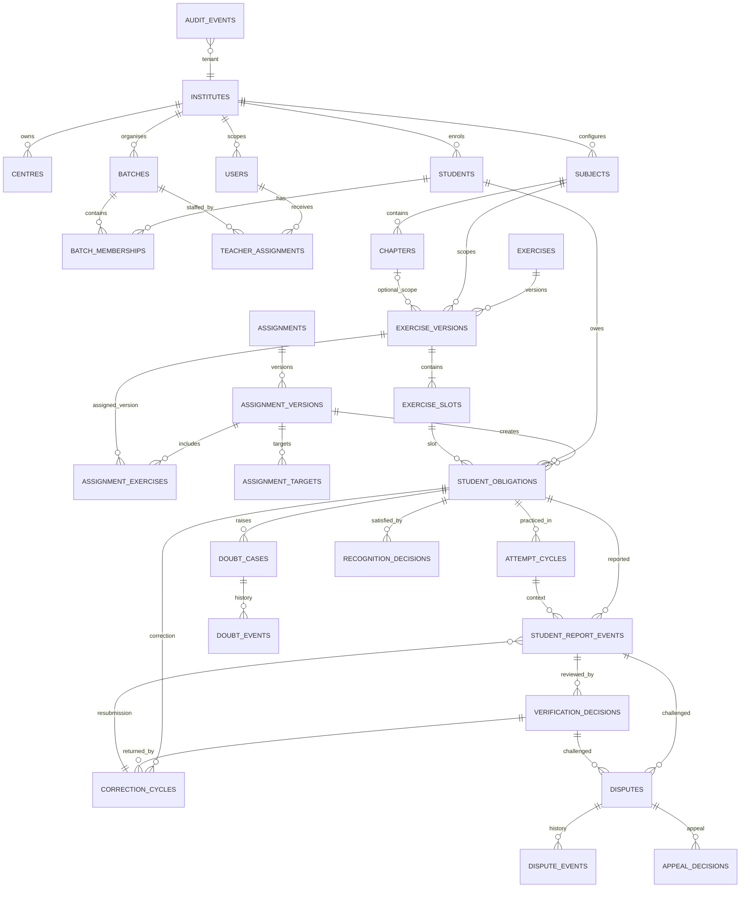

# System A — Student Work Tracking (Abhyas Matrix)
## Database Architecture and ER Baseline

**Status:** Proposed logical and physical design baseline; not executable migration SQL.  
**Repository:** `anshuljindalsecondbrain-art/pulse`  
**Branch:** `feat/system-a-abhyas-foundation`  
**Date:** 2026-11-06

## 1. Architectural contract

System A owns the academic work lifecycle: exercise definition, assignment publication, student obligations, student-reported evidence, teacher verification, corrections, repeated practice, doubts, disputes and derived progress.

System A MUST operate with only:
- institute/tenant;
- student and authorised batch membership;
- subject and optional chapter/syllabus scope;
- exercise label and version;
- numbered exercise slot (Q1…QN);
- assignment, due date and publication state.

System A MUST NOT require a question-bank record, topic, concept, sub-concept, archetype, difficulty tag or any DTE record.

System B/DTE may later link a slot to a stable question identity and version. Enrichment is a separate, versioned derived association. It must never update or reinterpret the source report or verification event.

### Source-of-truth hierarchy

1. Immutable published assignment/exercise versions define what was assigned.
2. Student obligations define each learner's responsibility for each eligible slot.
3. Append-only report events preserve what the learner reported.
4. Append-only verification decisions preserve what an authorised teacher/reviewer decided.
5. Correction, doubt, recognition and dispute records preserve their own workflows.
6. Progress, risk and radar data are rebuildable projections, never authoritative source records.

## 2. Core design decisions

| Concern | Baseline |
|---|---|
| Operational unit | One student × one assignment obligation × one exercise slot |
| Exercise identity | Stable exercise; immutable numbered versions |
| Assignment identity | Stable assignment; immutable published versions |
| Targeting | Batch and/or explicit student targets, resolved into a student snapshot at publication |
| Question reference | Nullable external question identity/version; local slot always exists |
| Student reporting | Append-only events; current state is a projection |
| Teacher verification | Independent append-only decisions with purpose and outcome |
| Attempt cycle | Explicit practice cycle; new revision assignment creates a new obligation |
| Correction | Separate correction cycle linked to the exact returned decision |
| Marks | Optional score/marking data, independent of question completion |
| Multi-chapter | Exercise slots may carry their own optional chapter/scope reference |
| Tenant security | Tenant-scoped relationships and database-enforced authorisation |
| DTE integration | Optional asynchronous enrichment, no source evidence mutation |

## 3. ER diagram — logical relationships

The diagram is a domain map, not a substitute for tenant-scoped composite foreign keys and RLS policies. Parent/guardian links and question/DTE enrichment links are omitted from the diagram for readability.

## 4. Entity catalogue

### 4.1 Identity and academic foundation

**institutes**
- `id`, name, status, timezone, configuration JSON/version, created_at.

**centres**
- `id`, `institute_id`, name, code, status.
- Unique institute-scoped code.

**users**
- `id` (auth identity), `institute_id`, display name, contact references, status.
- Do not use user-editable profile metadata as an authorisation source.

**students**
- `id`, `institute_id`, admission_number, name, class_level, stream, status.
- Unique admission number within institute where policy requires it.

**parent_student_links**
- `id`, `institute_id`, `parent_user_id`, `student_id`, relationship, status, valid_from/to.
- Parent visibility is read-only and only through an active authorised link.

**subjects / chapters**
- Tenant-scoped or explicitly shared reference data. Subject has code/name/status; chapter belongs to subject and carries class/syllabus metadata.
- Exercise chapter is optional for multi-chapter/cumulative work; individual slots can carry optional chapter references.

**batches / batch_memberships**
- Batch has institute, centre, academic session, class, stream and status.
- Membership has student, batch, valid_from, valid_to, status and recorded_by.
- Do not update/delete historical membership to represent a transfer. Close the old membership and create a new one.
- A transfer does not create old obligations or silently change their original assignment batch.

**teacher_assignments**
- Maps staff user to institute/centre/batch/subject and responsibility type (teaching, verification, substitute, administration), validity window and grantor.
- Access checks must evaluate current valid grants and action-specific authority.

### 4.2 Exercise definition

**exercises**
- Stable identity: `id`, `institute_id`, `created_by`, lifecycle state, created_at.
- No mandatory DTE/question-bank foreign key.

**exercise_versions**
- `id`, `exercise_id`, version_number, label, exercise_type, subject_id, optional chapter_id, target_question_count, optional max_marks, question_type_default_id or local configured code, instructions, marking_scheme_id (optional), status, created_at, created_by.
- Published versions are immutable. Edits create a new draft version.
- Question count and max marks are independent and may coexist.
- Exercise types include single-chapter DPP, multi-chapter, revision worksheet, cumulative, full-course mock, half-course test, practice assignment and question/marks assessment.

**exercise_slots**
- `id`, `exercise_version_id`, slot_number, display_label, optional question_type_id, optional chapter_id, optional max_marks, optional marking override, optional `question_id` and `question_version_id`, created_at.
- Unique (`exercise_version_id`, `slot_number`).
- Slot is the operational question reference on day one. Linking a real question later does not change slot identity.
- A slot may be unlinked, linked to one exact question version, or explicitly marked unavailable/removed in a later exercise version. Do not physically delete published slots.

### 4.3 Assignment and obligations

**assignments**
- Stable assignment identity: `id`, `institute_id`, created_by, created_at, current_version_id, lifecycle state.

**assignment_versions**
- `id`, `assignment_id`, version_number, publication_state (DRAFT, IN_REVIEW, APPROVED, PUBLISHED, SUPERSEDED, WITHDRAWN), release_at, due_at, timezone_snapshot, late_policy, resubmission_policy, approved_by, approved_at, published_at, immutable content snapshot/hash.
- Creator cannot approve own version.
- Release and due timestamps are distinct.
- Publication uses an idempotency key and transactionally creates obligations once.
- Published versions cannot be edited. Amendments create a new version and explicit obligation deltas.

**assignment_exercises**
- Join from assignment version to exact exercise version, with sequence_order and any assignment-level overrides.

**assignment_targets**
- Stores intended batch and/or explicit student targets, target type, target identifier, and publication-time resolution snapshot.
- Publication must resolve the eligible student list once. The resulting obligation set is explicit and auditable.
- A student joining a batch after publication does not inherit the assignment automatically.

**student_obligations**
- `id`, `institute_id`, `assignment_version_id`, `student_id`, `exercise_slot_id`, source batch membership snapshot, assigned_at, due_at, eligibility_state, satisfaction_state, created_by, idempotency_key.
- Unique key should prevent duplicate creation for the same assignment version + student + slot; do not use a mutable batch id as the sole identity.
- Eligibility/satisfaction changes are recorded in obligation events or dedicated decisions, not by erasing history.
- Removed/exempted/recognised/disputed are independent flags or decision records, not a giant status enum.

**obligation_events**
- Append-only lifecycle events for assignment changes, exemptions, removal, reassignment, deadline changes and explicit backlog creation.
- Record actor, reason, source version, timestamp and affected obligation.

### 4.4 Attempt and student report evidence

**attempt_cycles**
- `id`, `student_obligation_id`, cycle_number, cycle_type (INITIAL, PRACTICE, REVISION), started_at, ended_at, initiated_by, source_assignment/reference, notes.
- New revision assignment creates a new obligation. A second attempt under the same obligation is a new cycle only when policy defines it as a distinct practice cycle.
- Correction/resubmission does not create a new practice cycle.

**student_report_events**
- `id`, `institute_id`, `student_obligation_id`, `attempt_cycle_id`, optional `correction_cycle_id`, reported_state, student_remark, actor_user_id, event_at, client_event_id/idempotency_key, supersedes_event_id (optional), source_channel.
- Reported states: UNATTEMPTED, ATTEMPTED, REPORTED_COMPLETE, DOUBT, SKIPPED, PARTIALLY_COMPLETE.
- UNATTEMPTED is the absence/default projection state; a persisted event is only needed when a student explicitly confirms/reset action or policy requires it.
- Student reports cannot be edited or deleted. A correction to a mistaken report appends a new event with a supersedes reference.
- A report is not proof of answer correctness or teacher verification.

### 4.5 Independent teacher verification

**verification_decisions**
- `id`, `institute_id`, `student_obligation_id`, `report_event_id`, verifier_user_id, verification_purpose, decision_outcome, remarks, decided_at, supersedes_decision_id, reviewer_assignment_id.
- Purposes: ATTEMPT_CONFIRMED, COMPLETION_CONFIRMED, ANSWER_EVALUATED, CORRECTION_CONFIRMED, INDEPENDENT_SOLVE_CONFIRMED.
- Outcomes should be purpose-specific (e.g. CONFIRMED / NOT_CONFIRMED for attempt or completion; CORRECT / INCORRECT / PARTIALLY_CORRECT / NOT_EVALUATED for answer evaluation; RETURNED / ACCEPTED for correction). Do not collapse purpose and outcome into a single VERIFIED state.
- Bulk actions must create one decision per obligation/report pair.
- Verifier authority is checked independently from assignment creator and batch access.

### 4.6 Correction, doubts and disputes

**correction_cycles**
- `id`, `student_obligation_id`, returned_verification_decision_id, cycle_number, return_reason, requested_by, requested_at, due_at, state, closed_at.
- States: REQUIRED, RESUBMITTED, CONFIRMED, CANCELLED.
- Student resubmission is a new report event linked to the correction cycle.
- The original report and returned decision remain unchanged.

**doubt_cases / doubt_events**
- Doubt case references exact student obligation and originating report event; includes assigned teacher, priority, state, opened_at, resolved_at.
- Doubt events append assignment, escalation, response, resolution and student-confirmation events.
- Resolution by teacher is not the same as a student saying the question was solved independently.
- A cohort-level “resolved for class” action must create individual resolution events only for the students included in the action snapshot.

**disputes / dispute_events / appeal_decisions**
- Dispute references exact report and/or verification decision; records claimant, reason, status, reviewer and SLA timestamps.
- Appeal reviewer must be independent of the original verifier. Conflicts require reassignment.
- A new practice attempt cannot decide a dispute about an earlier attempt.
- SLA breach triggers escalation, never an automatic academic decision.
- Disputed work remains visible and excluded from verified-complete metrics until policy-specific resolution.
- Final outcome is a new decision that supersedes the challenged decision; never mutate the original.

### 4.7 Recognition and DTE enrichment

**question_equivalences**
- Explicit, reviewed equivalence between exact question identities/versions; relation type (ONE_TO_ONE, ONE_TO_MANY, MANY_TO_ONE), evidence, reviewer, approval and validity.
- Similarity/AI score alone cannot satisfy an obligation.

**recognition_decisions**
- References target obligation and exact source evidence (source obligation, report and verification decision), equivalence record/policy version, decision (RECOGNISED, NOT_RECOGNISED, FRESH_PRACTICE_REQUIRED, REVOKED), actor, reason and timestamp.
- Recognition revocation preserves the original decision and triggers recalculation of affected projections.

**question_enrichment_links**
- Optional link from slot/evidence context to exact question identity/version and classification mapping revision.
- DTE enrichment is additive and asynchronous. It cannot alter reports, verification decisions or obligation history.
- Store enrichment job id, source slot, question/version, mapping/schema revision, status and processed_at.

### 4.8 Audit and projections

**audit_events**
- `id`, `institute_id`, actor, action, target_type/id, before/after summary where appropriate, reason, request/correlation id, occurred_at.
- Protected from ordinary user update/delete. Do not store secrets or unnecessary student PII in audit payloads.

**progress_projection**
- Rebuildable current-state aggregate keyed by obligation/student/assignment/exercise version; projection version and computed_at included.
- Can be a materialized view or maintained projection table after measured workload warrants it.
- Never the only copy of a report or verification decision.

**analytics_refresh_jobs**
- Durable, tenant-scoped, idempotent job records for progress, doubt radar, risk and historical DTE enrichment.

## 5. Status dimensions and state transitions

Do not create one status enum for the entire lifecycle.

| Dimension | States / examples |
|---|---|
| Assignment publication | DRAFT, IN_REVIEW, APPROVED, PUBLISHED, SUPERSEDED, WITHDRAWN |
| Student report | UNATTEMPTED, ATTEMPTED, REPORTED_COMPLETE, DOUBT, SKIPPED, PARTIALLY_COMPLETE |
| Verification purpose | ATTEMPT_CONFIRMED, COMPLETION_CONFIRMED, ANSWER_EVALUATED, CORRECTION_CONFIRMED, INDEPENDENT_SOLVE_CONFIRMED |
| Verification outcome | Purpose-specific decision values |
| Correction | REQUIRED, RESUBMITTED, CONFIRMED, CANCELLED |
| Doubt | OPEN, ASSIGNED, IN_PROGRESS, RESOLVED, REOPENED, ESCALATED |
| Dispute | OPEN, UNDER_REVIEW, APPEALED, RESOLVED, WITHDRAWN |
| Recognition | RECOGNISED, NOT_RECOGNISED, FRESH_PRACTICE_REQUIRED, REVOKED |
| Obligation eligibility | ELIGIBLE, REMOVED, EXEMPTED |
| Obligation satisfaction | UNSATISFIED, SATISFIED_BY_WORK, SATISFIED_BY_RECOGNITION |

All state changes are events/decisions with actor, timestamp and reason. A current-state read model may be maintained transactionally or asynchronously, but must be reproducible from source records.

## 6. Progress calculation contract

Define a versioned metric policy. Do not infer the denominator from all historical student records.

For a student and assignment version:

- **Current eligible obligations** = obligations in the selected assignment version with eligibility_state = ELIGIBLE, excluding withdrawn/removed obligations according to policy.
- **Reported complete** = eligible obligations whose latest valid student report in the selected cycle is REPORTED_COMPLETE or whose accepted recognition satisfies the obligation. Show recognition separately.
- **Verified complete** = eligible obligations with a valid COMPLETION_CONFIRMED or CORRECTION_CONFIRMED decision for the current accepted report, plus accepted recognition where the metric policy explicitly includes it.
- **Attempted** = eligible obligations with a recorded ATTEMPTED / REPORTED_COMPLETE / DOUBT / PARTIALLY_COMPLETE event or qualifying verified attempt. SKIPPED is not an attempt.
- **Correctness** = answer-evaluation decisions only. Correctness denominator is evaluated obligations, not all assigned obligations and not all attempted obligations.
- **Doubt pending** = open doubt cases, not merely every historical DOUBT report.
- **Returned / correction pending** = obligations with an open correction cycle.
- **Disputed** = obligations with an active dispute; show separately and do not silently count as verified.
- **Fresh practice required** = explicit recognition decision requiring another attempt.

Formulas:

`Reported Progress = reported-complete eligible obligations / eligible current obligations × 100`

`Verified Progress = verified-complete eligible obligations / eligible current obligations × 100`

`Accuracy = correct evaluated obligations / all evaluated obligations × 100`

A policy must specify how recognised, exempted, disputed and superseded slots are shown. Report all counts alongside percentages. Return zero/undefined safely when denominator is zero.

Every historical report must be reproducible for an as-of timestamp, assignment version, obligation set and metric-policy version.

## 7. Assignment versioning and obligation delta rules

- Publish transactionally: approve version, freeze its content snapshot, resolve targets, create obligations and record publication event.
- Idempotency key scoped to assignment version and publication operation prevents duplicate obligations on retries.
- Adding Q21/Q22 in a new assignment version creates obligations only for the newly added slots and eligible target set; preserve old obligations and evidence.
- Removing a slot creates a versioned ineligibility/removal decision for current obligations; preserve prior evidence and denominator history.
- Re-adding a slot creates a new eligible obligation or explicit reactivation decision according to institute policy; never revive by overwriting old evidence.
- A new student joining after publication does not inherit the assignment. Backlog requires explicit target creation.
- A student transfer does not move old obligations to a new batch. New teacher visibility is based on current authorised relationship plus historical access policy.
- Assignment release time and due time use an explicit IANA timezone snapshot. Store UTC instants plus the configured timezone identifier.

## 8. Security and tenant isolation

RLS and trusted server-side authorization must enforce:
- deny by default;
- institute/centre boundary;
- student self-access;
- parent-to-linked-child read-only access;
- teacher access only for current authorised subject/batch/student responsibilities;
- verifier authority separate from creator;
- reviewer/appeal independence;
- admin authority scoped to institute and function;
- explicit historical access rules;
- no cross-tenant leakage through views, RPCs, exports, storage or background jobs.

Use tenant-aware unique keys and composite foreign keys where appropriate to prevent cross-tenant parent/child references. Every exposed table needs RLS. Views must be checked for RLS bypass behavior. SECURITY DEFINER functions require exceptional justification, fixed search_path, explicit auth checks, narrow grants and security review.

## 9. Indexing and scale strategy

Initial likely indexes (validate with EXPLAIN ANALYZE on representative data):
- `student_obligations(institute_id, student_id, assignment_version_id)`;
- `student_obligations(institute_id, assignment_version_id, eligibility_state)`;
- `exercise_slots(exercise_version_id, slot_number)`;
- `student_report_events(student_obligation_id, event_at DESC)`;
- `verification_decisions(student_obligation_id, decided_at DESC)`;
- `verification_decisions(verifier_user_id, decided_at) WHERE decision is pending/review workflow as applicable`;
- `doubt_cases(institute_id, assigned_teacher_id, state, opened_at)`;
- `correction_cycles(student_obligation_id, state)`;
- `assignment_versions(assignment_id, version_number)`;
- `batch_memberships(institute_id, batch_id, student_id, valid_from, valid_to)`.

Use keyset pagination for large matrix rosters and question slots. Do not fetch all student evidence for all assignments into the browser. Matrix APIs should fetch one assignment/exercise version, a bounded student page and a bounded slot range, with aggregate counts computed server-side.

## 10. Migration strategy from the legacy tracker

No legacy migration can be written safely until the live schema and application queries are inspected.

Proposed staged migration:
1. Inventory existing tables, enums, views, RPCs, triggers, RLS and row counts.
2. Map legacy exercise/item and question slots to stable exercise/version/slot identities.
3. Map each legacy student-item assignment to an obligation candidate, preserving original batch and assignment timestamps.
4. Convert legacy status rows into clearly labelled legacy-import report or teacher-entry events only when actor/source semantics are provable. Never fabricate whether a legacy status was student-reported or teacher-verified.
5. Mark ambiguous legacy statuses as LEGACY_UNCLASSIFIED evidence with provenance; exclude them from verified metrics until reviewed.
6. Dual-read or compare old/new projections in a non-production environment.
7. Reconcile row counts, orphan references, tenant boundaries and progress totals.
8. Cut over writes only after tests pass and rollback plan is approved.
9. Retain old tables read-only for a defined reconciliation window; archive only after explicit approval.

## 11. Required database test suite

- tenant isolation for every table, view, RPC and parent/teacher relationship;
- student can only read/write own obligations and reports;
- parent can read linked child but cannot mutate;
- teacher batch/subject scope and verifier authority;
- creator cannot approve own assignment;
- duplicate publication retry creates no duplicate obligations;
- published exercise/assignment versions cannot be mutated;
- slot numbering uniqueness and immutable history;
- student transfer preserves historical evidence;
- new student does not inherit historical assignments;
- revision assignment creates a new obligation;
- correction does not create a new practice attempt;
- returned question is not counted verified complete;
- answer correctness is independent of completion;
- dispute/appeal reviewer independence;
- recognition revocation recalculates projections without deleting source evidence;
- historical as-of calculations are deterministic;
- DTE enrichment is idempotent and does not mutate evidence;
- matrix bulk save is atomic or reports per-row failures explicitly.

## 12. Open policy decisions

These should be institute-configurable or explicitly locked before final DDL:
- exact allowed question/report state transitions;
- whether students may submit partial reports and how often;
- late submission policy and due-date grace;
- resubmission and correction deadlines;
- verification SLAs and substitute-teacher authority;
- who may exempt/remove/reassign obligations;
- whether a recognised question counts in reported/verified completion;
- one-to-one equivalence approval policy;
- marks/partial marks and negative marks policy;
- parent visibility for teacher remarks and dispute outcomes;
- retention and archival policy;
- whether a teacher may see all historical work or only authorised historical scope.

**Implementation gate:** This document is an architecture baseline. It is not permission to apply SQL to production. Final DDL depends on live Supabase schema inspection, current migration history, RLS review and approved migration design.
