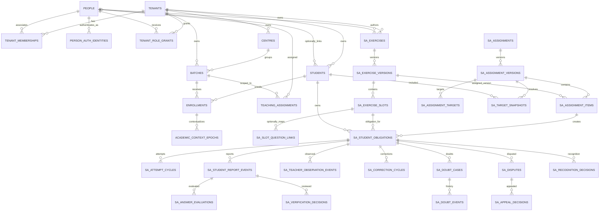
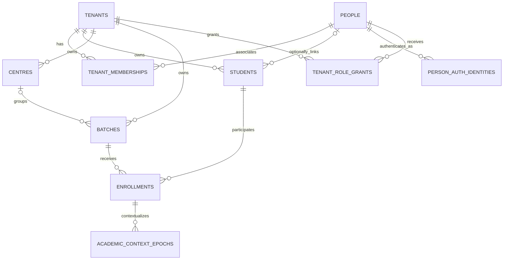

# System A — Physical ERD Reconciliation with Shared PULSE Identity

**Document ID:** STS-DB-ERD-001  
**Version:** 1.0.0  
**Status:** Reconciled target proposal — shared identity direction frozen; physical core extensions and owner decisions remain pending  
**Date:** 2026-11-07  
**Decision:** Shared PULSE identity is the permanent source of truth for System A.

## 1. Scope and evidence boundary

This ERD reconciles the System A logical model with the actual shared-core branch `feat/pulse-domain-core`.

Inspected shared-core source:
- `supabase/migrations/0001_identity_and_academic_context.sql`, blob `bd97679c6742462d31bf6443c493f0f5615ec0b8`.
- `src/domain/identity.ts`, blob retrieved from the same branch.
- `src/domain/academic-context.ts`, blob retrieved from the same branch.
- `AGENTS.md`, blob `fe890992723358d7731287bcf4aecdbcbe895f64`.

The actual shared-core migration currently creates only:
- `public.tenants(id, name, created_at)`
- `public.people(id, created_at)`
- `public.tenant_people(id, tenant_id, person_id, created_at)`, unique `(tenant_id, person_id)`
- `public.students(id, tenant_person_id, created_at)`
- `public.academic_context_epochs(id, tenant_id, student_id, batch_id, stream, class_level, valid_from, valid_to, reason, created_at)`

The shared-core migration explicitly says it is an architectural boundary only and that production RLS policies and application-specific constraints must be added before tenant data is exposed.

The shared-core SQL does **not** yet define Auth-to-person mapping, role grants, centres, batches, explicit enrolment records, teacher assignments or the required composite tenant foreign keys. The TypeScript identity model declares roles, but that is not a persisted authorization model. The academic context TypeScript interface has teacher IDs, while the inspected SQL epoch table does not contain teacher IDs.

Therefore this ERD freezes ownership and relationship direction, but does not claim the current shared-core migration is complete or production-safe.

## 2. Frozen ownership rules

1. PULSE owns tenant, person, authentication identity mapping, tenant-person membership, role grants, student identity, centres, batches and effective-dated academic enrolment/context.
2. System A references those canonical records; it must not create `sa_institutes`, `sa_users`, `sa_students`, `sa_centres`, `sa_batches` or a second membership authority.
3. System A owns exercises, exercise versions, exercise slots, assignments, assignment versions/items/targets, target snapshots, student obligations, reports, teacher observations, evaluations, verification, corrections, doubts, disputes, appeals, recognition and its projections.
4. QBMS owns question identity and question versions. System A holds an optional exact-version link from an exercise slot.
5. System B/DTE owns taxonomy and classification. System A stores optional enrichment references/snapshots only where needed for historical reproducibility.
6. All business actors are canonical `people.id`; Supabase Auth UUIDs are authentication principals and must map to a person through a shared identity table.
7. Tenant ownership is explicit on System A aggregates and enforced on every relationship using tenant-qualified unique keys/FKs where PostgreSQL supports the constraint.

## 3. Reconciled target ERD

The following Mermaid ERD distinguishes existing shared-core tables from required shared-core extensions and System A-owned tables. Dashed/labelled extension entities are proposed; they are not deployed.

ERD note: the diagram is a logical relationship map, not executable DDL. Every System A-owned table must carry `tenant_id` or be protected through a tenant-qualified parent relationship. A tenant-qualified composite FK design is mandatory even where the simplified diagram omits the tenant column.

## 4. Shared PULSE core — physical reconciliation

| Entity | Current physical source | Frozen owner | Reconciliation / required work |
|---|---|---|---|
| Tenant | `public.tenants` | PULSE | Reuse; add status/timezone/config only through shared-core governance |
| Person | `public.people` | PULSE | Reuse; avoid duplicating name/contact fields in System A |
| Tenant membership | `public.tenant_memberships` | PULSE | Canonical association under DEC-012; legacy `tenant_people` is source migration input only |
| Auth identity | Not present in inspected migration | PULSE | Add `person_auth_identities` with provider + auth subject uniqueness, person FK, verified/effective state |
| Tenant role grant | Not present | PULSE | Add `tenant_role_grants`; separate role/action/resource scope from tenant-person membership |
| Student | `public.students` | PULSE academic core | Tenant-owned; mandatory `tenant_id`, optional `person_id`; no membership FK |
| Centre | Not present | PULSE academic core | Add canonical `centres` with tenant-scoped code and status |
| Batch | Referenced by nullable `academic_context_epochs.batch_id`, but no table/FK exists | PULSE academic core | Add canonical `batches`; add FK and tenant-qualified relationship |
| Enrollment/context | `public.enrollments`, `public.academic_context_epochs` | PULSE academic core | Add explicit student-to-batch enrollment; context epochs reference enrollment; concurrency policy remains OPEN-010 |
| Teaching assignment | Not present | PULSE authorization/academic core | Add explicit person-to-centre/batch/subject responsibility with validity and grantor |
| Parent/guardian link | Not present in inspected core | PULSE identity/relationship service | Add verified, temporal person-to-student relationship; do not create System A-local guardian identity |

### 4.1 Critical shared-core corrections

- `tenant_memberships` is a tenant association, not an authorization grant. Never infer `ADMIN` or `TEACHER` from membership alone.
- `src/domain/identity.ts` defines a TypeScript `Role` union and role check. This does not replace persisted role grants, resource scope, expiry, revocation or database authorization.
- The historical source `academic_context_epochs.batch_id` is an unconstrained UUID. Under DEC-012, batch is reached through `enrollments`; do not retain a direct batch pointer on context epochs.
- The SQL epoch has no `teacher_ids`, although the TypeScript interface includes it. Teaching responsibilities should be represented by a normalized teaching-assignment relation, not a mutable array embedded in an epoch.
- `students` must carry authoritative `tenant_id` and nullable `person_id`; add UNIQUE `(tenant_id,id)`. Enrollments and context epochs use tenant-qualified composite FKs.
- The historical `students.tenant_person_id` relationship is superseded. Students do not reference `tenant_memberships`; membership and student identity are independent.
- Auth UUIDs must not be used as business actor FKs in System A. Actor columns reference `people.id`; request authentication resolves Auth UID to person ID in trusted code.
- Existing shared-core migration has no production RLS or role grants. Do not expose it to application traffic as a production authorization model.

## 5. System A-owned physical table proposal

Names below use `sa_` prefix to mark System A ownership. They are proposed physical names, not deployed objects. Avoid duplicating the existing legacy proposal's structures without normalization and tenant-FK corrections.

| Proposed table | Key relationships | Core purpose |
|---|---|---|
| `sa_exercises` | tenant_id → tenants; created_by_person_id → people | Stable exercise aggregate |
| `sa_exercise_versions` | exercise_id; version_no unique per exercise | Immutable content/version |
| `sa_exercise_slots` | exercise_version_id; slot_no unique per version | Stable numbered slot independent of QBMS |
| `sa_slot_question_links` | slot_id; optional external question_id + question_version_id | Exact-version QBMS mapping, no assumed FK until QBMS contract |
| `sa_assignments` | tenant_id; created_by_person_id | Stable assignment aggregate |
| `sa_assignment_versions` | assignment_id; version_no; author/approver/publisher person IDs | Immutable draft/approved/published version |
| `sa_assignment_items` | assignment_version_id + exercise_version_id | Exact exercise versions included |
| `sa_assignment_targets` | assignment_version_id; target type/ref | Intended batch/student/cohort targeting |
| `sa_target_snapshots` | assignment_version_id; student_id; source context/enrolment snapshot | Publication-time resolved roster |
| `sa_student_obligations` | assignment item, slot, student, source snapshot, tenant | One student's responsibility for one assigned slot |
| `sa_obligation_events` | obligation_id; actor_person_id | Amendment, exemption, withdrawal, recognition provenance |
| `sa_attempt_cycles` | obligation_id; initiated_by_person_id | Practice/revision cycle |
| `sa_student_report_events` | obligation_id; attempt_cycle_id; actor_person_id | Append-only student self-report |
| `sa_teacher_observation_events` | obligation_id; actor_person_id; teaching assignment | Append-only teacher observation |
| `sa_answer_evaluations` | exact report/evidence; evaluator_person_id | Correctness decision independent of completion |
| `sa_verification_decisions` | exact report/evidence; reviewer_person_id | Purpose-specific verification |
| `sa_correction_cycles` | obligation_id; source returned decision | Correction workflow aggregate |
| `sa_correction_events` | correction_cycle_id; actor_person_id | Append-only correction transitions |
| `sa_doubt_cases` | obligation_id; opener/assignee person IDs | Doubt workflow aggregate |
| `sa_doubt_events` | doubt_case_id; actor_person_id | Append-only doubt history |
| `sa_disputes` | obligation + exact challenged evidence/decision | Challenge lifecycle |
| `sa_dispute_events` | dispute_id; actor_person_id | Append-only dispute history |
| `sa_appeal_decisions` | dispute_id; independent reviewer person | Appeal outcome |
| `sa_recognition_decisions` | obligation + exact source evidence + policy version | Previous work equivalence decision |
| `sa_audit_events` | tenant_id nullable only for platform event; actor person | Restricted audit trail |
| `sa_outbox_events` | tenant_id; aggregate; idempotency key | Reliable downstream event delivery |
| `sa_projection_runs` | tenant_id; policy version; source watermark | Rebuildable analytics provenance |

The System A physical table set is intentionally more normalized than the 26-table legacy proposal. It separates teacher observations from student reports, answer evaluation from completion verification, and mutable workflow projections from append-only event histories.

## 6. Tenant-qualified integrity pattern

For each tenant-owned parent, establish a candidate unique key `(tenant_id, id)`. Child records carry `tenant_id` and reference parents with composite foreign keys, for example:

- System A actor relationships resolve to canonical `people.id`; authorization independently verifies tenant membership and scoped role grants. Do not treat student/person links as membership.
- `sa_exercise_versions(tenant_id, exercise_id)` → `sa_exercises(tenant_id, id)`.
- `sa_exercise_slots(tenant_id, exercise_version_id)` → `sa_exercise_versions(tenant_id, id)`.
- `sa_assignment_items(tenant_id, assignment_version_id)` → `sa_assignment_versions(tenant_id, id)`.
- `sa_assignment_items(tenant_id, exercise_version_id)` → `sa_exercise_versions(tenant_id, id)`.
- `sa_student_obligations(tenant_id, student_id)` → shared `students` tenant-qualified key.
- `sa_student_obligations(tenant_id, assignment_item_id)` → `sa_assignment_items(tenant_id, id)`.
- `sa_student_obligations(tenant_id, exercise_slot_id)` → `sa_exercise_slots(tenant_id, id)`.
- `sa_student_report_events(tenant_id, obligation_id)` → `sa_student_obligations(tenant_id, id)`.

Additional checks/constraints must prove that the obligation slot belongs to the exact exercise version referenced by its assignment item and that the student belongs to the publication-time target snapshot. Composite FKs alone do not enforce all cross-entity semantic joins.

## 7. Relationship cardinalities and uniqueness candidates

- Tenant ↔ Person: many-to-many through `tenant_memberships`; membership is independent of student identity.
- Person ↔ Auth identity: one-to-many to support multiple auth providers/identities; unique provider + subject.
- Tenant ↔ Student: one-to-many tenant-owned student identities; optional person link. No membership-to-student cardinality.
- Tenant ↔ Role grant: one-to-many; person can hold multiple roles/scopes.
- Tenant ↔ Centre ↔ Batch: one-to-many.
- Student ↔ Academic context epoch: one-to-many temporal records; non-overlap policy must be defined.
- Batch ↔ Academic context epoch: one-to-many.
- Person ↔ Teaching assignment: one-to-many, effective-dated and scoped.
- Exercise ↔ Exercise version: one-to-many; unique version_no per exercise.
- Exercise version ↔ Slot: one-to-many; unique slot_no per version.
- Assignment ↔ Assignment version: one-to-many; unique version_no per assignment.
- Assignment version ↔ Item: one-to-many.
- Assignment version ↔ Target: one-to-many.
- Assignment version ↔ Target snapshot: one-to-many students at publication.
- Student ↔ Obligation: one-to-many.
- Assignment item ↔ Obligation: one-to-many per eligible target student.
- Obligation ↔ Report, evaluation, verification, correction and doubt: one-to-many history records.

## 8. Unresolved physical decisions

Shared identity direction is frozen, but these physical details remain open and must not be guessed:

1. Does `tenant_people` remain the canonical membership table, with a new `tenant_role_grants`, or is it renamed to `tenant_memberships`? Recommendation: retain `tenant_people` to avoid parallel membership tables; add role grants separately.
2. Is a person allowed to have multiple student records/programmes within one tenant? Recommendation: one canonical student identity per tenant-person, with multiple effective-dated enrolments/context epochs.
3. Can a student have concurrent active batches/programmes? Must be explicit in enrolment constraints.
4. Are subjects/chapters shared platform catalogue records, tenant-owned copies or tenant overlays?
5. Does teacher scope live in role grants, teaching assignments or both? Recommendation: role grant establishes capability; teaching assignment establishes resource scope; require both.
6. What are the canonical parent/guardian relationship verification and consent fields?
7. Which class/stream/course eligibility policy applies to the first publication engine?
8. Which evidence types are student-reported versus teacher-observed in the current Abhyas Matrix?
9. Is answer evaluation a separate table from completion verification? Recommendation: separate `sa_answer_evaluations`.
10. What is the authoritative timezone source and assignment deadline snapshot policy?

## 9. Migration disposition

- Do not apply `20261106000100_system_a_initial_schema.sql` unchanged.
- Do not apply the current shared-core migration to the connected PULSE Supabase project without a reviewed, ordered migration and RLS implementation.
- The shared-core migration and System A schema must be integrated into one canonical migration history; do not maintain parallel histories or duplicate table ownership.
- No Supabase DDL, data, RLS, grants or application runtime was changed as part of this ERD reconciliation.
- The next technical deliverable is a reviewed physical column dictionary and exact composite-FK/constraint matrix, followed by a single migration plan and executable test fixtures.

## 10. Acceptance criteria for the ERD

- Shared identity ownership is used by every System A actor and tenant relationship.
- No System A-local tenant/person/Auth/student/centre/batch/membership authority exists.
- All System A aggregates are tenant-qualified.
- Cross-tenant references are structurally impossible through composite keys/FKs.
- Exercise slot is independent of optional QBMS question identity.
- DTE taxonomy is not a System A-owned dependency.
- Reports, observations, evaluations, verification and workflow events preserve distinct provenance.
- Publication snapshots exact target students and creates obligations atomically/idempotently.
- Historical academic evidence is append-only and immutable.
- All table access has a documented actor/scope and server command boundary.

---

## 11. Source-driven correction to the initial physical proposal

The uploaded System A functional specification and subsequent explicit clarification establish that teachers primarily select existing questions from offline modules whose tagging is already available. They are not normally building exercises or authoring questions in System A.

Accordingly, the column-level physical design in [PHYSICAL_DATABASE_BLUEPRINT.md](PHYSICAL_DATABASE_BLUEPRINT.md) supersedes the exercise-first operational path proposed in Sections 5–7 above:

`sa_source_catalogs → sa_source_editions → sa_source_questions → sa_assignment_items → sa_target_snapshots → sa_student_obligations`.

Exercise versions/slots may be retained only as a packaging or UI abstraction where required by an existing workflow. They are not the canonical source of question content and must not be required to select/assign a question. The stable assignment item and source-question reference are the operational unit for the first release.

This correction does not change the frozen shared identity ownership decision. It corrects the System A source/assignment domain to match the uploaded product requirements.

---

## 12. Owner-approved physical identity correction — DEC-012 (2026-11-07)

**Authority:** This section supersedes every conflicting membership/student/enrollment statement and diagram in earlier sections of this document. It does not change System A ownership boundaries or any other approved decision.

### 12.1 Canonical shared-core relationship model

### 12.2 Binding physical rules

1. `tenant_memberships` replaces `tenant_people` as the canonical table name for the person-to-tenant association. Legacy `tenant_people` is migration-source history only; do not create parallel live authorities.
2. `tenant_role_grants` remains separate. Membership does not imply role, permission or resource access.
3. `students` is tenant-owned: mandatory `tenant_id`, nullable `person_id` referencing `people.id`. No FK from students to tenant_memberships; student creation does not require a tenant membership.
4. Enforce a tenant-qualified student key, e.g. UNIQUE `(tenant_id,id)`.
5. Add `enrollments` as the explicit effective-dated relationship from a tenant-owned student to a same-tenant batch. It is the authoritative student-to-batch relationship.
6. `academic_context_epochs` references `(tenant_id,enrollment_id)`. Remove the direct batch relationship from the context epoch model; batch is reached through enrollment.
7. Use composite tenant-qualified FKs for student, batch, enrollment and context relationships. A nullable `person_id` is not an authorization grant and must not be used to infer membership.
8. Preserve enrollment/context history; do not cascade-delete academic history.
9. Concurrent active-enrollment/overlap policy remains blocked under OPEN-010/RECON-004 pending Academic Owner approval. Do not add one-active-enrollment uniqueness or temporal exclusion constraints yet.

### 12.3 Reconciliation disposition

- RECON-001, RECON-002 and RECON-003: closed by DEC-012.
- RECON-004: blocked pending Academic Owner approval.
- Earlier references to `tenant_people`, `students.tenant_person_id`, student-to-membership cardinality, direct `academic_context_epochs.batch_id`, or one context per student are superseded.
- All other approvals remain unchanged, including Auth mapping, centres/batches, canonical branch direction and internal-only M0001 security boundary.
